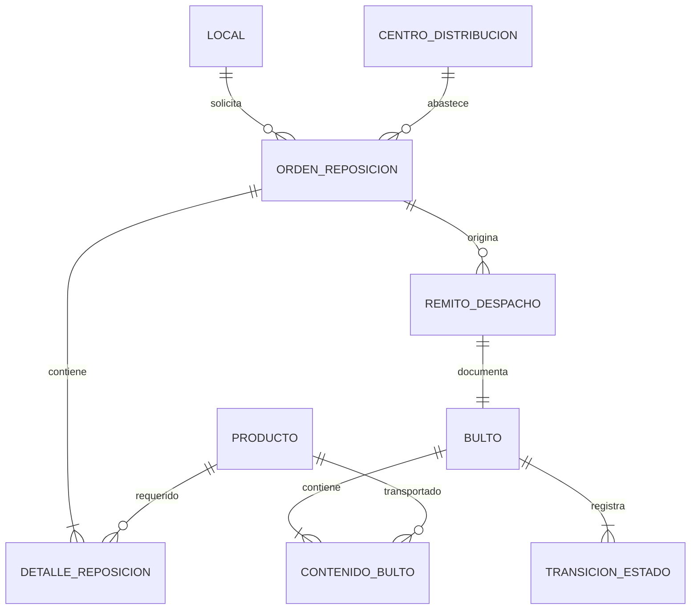
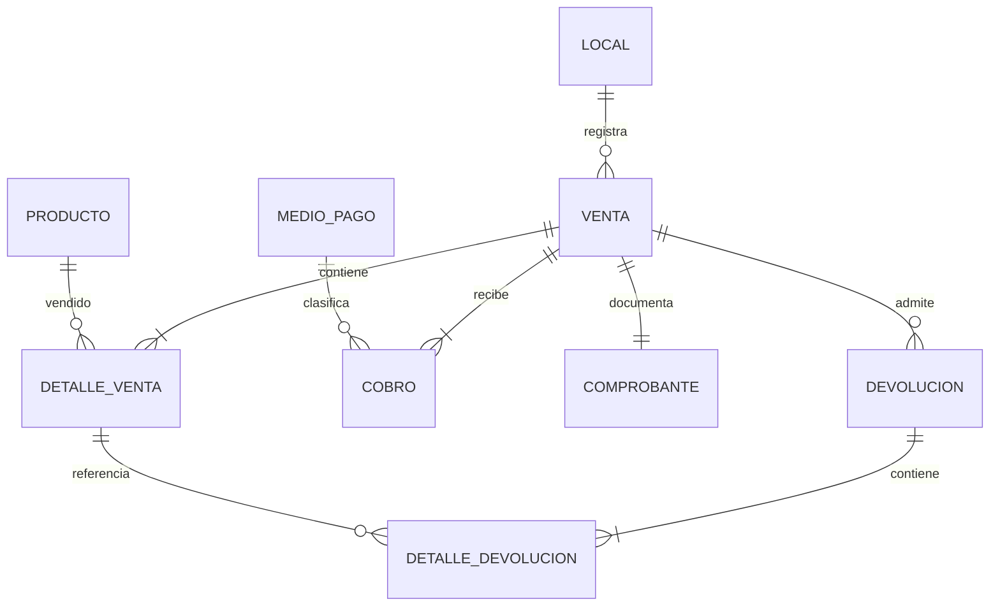
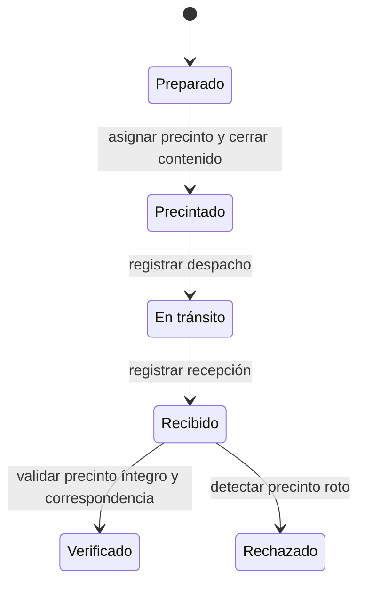

# TPI 2026 - Tema 3: análisis del dominio y modelo conceptual inicial

**Sistema de Ventas e Inventario: Centro de Distribución a Locales**

Estado actualizado: 31/10/2026. Análisis original: 11/10/2026. Las [decisiones de implementación](decisiones_implementacion.md) resuelven las dudas iniciales y prevalecen sobre las propuestas históricas de las secciones siguientes. El [modelo de datos](modelo_datos.md) refleja el incremento ejecutable.

## 1. Alcance de esta entrega y fuentes

Este documento conserva el análisis del enunciado, el modelo conceptual y la evaluación inicial de patrones. El repositorio implementa catálogo, compras, logística, costos, ventas, cobros, caja y comprobantes con interfaz y SQLite 3; aplica State, DAO y Singleton. Devoluciones vinculadas y cuatro reportes no triviales se incorporaron en `codex/devoluciones-reportes`; véanse cobertura verificada y reportes. Los diagramas de clases y DER implementados se mantienen en sus documentos específicos; las propuestas históricas de este análisis no sustituyen la cobertura verificada.

### Fuentes y prioridad

| Fuente | Lectura utilizada | Función |
|---|---|---|
| `TPI-tema3.pdf` | Las dos páginas completas, con extracción de texto y revisión visual | Fuente obligatoria del alcance, procesos, validaciones y mínimos de entrega |
| `semana4.pdf` | Capítulos 7, 8 y 9; especialmente pp. 79-84, 89, 91-94 y 101-106 del material | Objetos con comportamiento, encapsulamiento, composición y agregación |
| `semana-05.pdf` | Herencia, pp. 111-113; consulta de polimorfismo | Relaciones «es un» y uso justificado de jerarquías |
| `semana-08.pdf` | Transacciones, pp. 148-149; patrón DAO, pp. 153-156 | Persistencia separada y operaciones atómicas |
| `semana-09.pdf` | Singleton, pp. 189-191 y 202-203; State/Strategy, pp. 205-219 | Evaluación de candidatos a patrones y alternativas |
| `semana1.pdf`, `semana2.pdf`, `semana3.pdf` | Inspección del temario y contenido inicial | Contexto de Python, programación funcional y archivos; no se extraen nuevas obligaciones para el TP |
| `Repositorio-de-Ejercicios.txt` | Completo | Remite al repositorio oficial |
| [UTN-DAO/2026-guias](https://github.com/UTN-DAO/2026-guias) | README, estructura, sección de persistencia y modelo PlantUML del ejercicio integrador | Referencia metodológica; conserva diagramas textuales y aborda SQLite |
| [G12_TPI_DAO_Reservas_De_Canchas](https://github.com/AgusCeballosPratto/G12_TPI_DAO_Reservas_De_Canchas) | README y estructura de raíz | Ejemplo de documentación, DER, clases y separación de persistencia de otro TP |

Los números de página del material complementario son los impresos, no la posición dentro de cada PDF. No se identificaron correcciones docentes específicas de este TP entre los archivos recibidos. El trabajo del año anterior es una referencia estudiantil: no acredita criterios de evaluación ni reemplaza la consigna de 2026.

### Estado del repositorio

Integración original: 12/10/2026, rama `codex/plan-avance-tp`. El avance posterior `antigravity/paso1-y-singleton` agregó ventas y costos; las correcciones del 28/10 se encuentran en `codex/correcciones-costos-singleton`. El estado y los siguientes incrementos se mantienen en [plan de avance](plan_avance.md).

Se conserva el contenido del análisis como propuesta revisable. El 12/10/2026 se leyeron las dos páginas de `dao/TPI-tema3.pdf` y se confirmó la correspondencia de R01-R17 con sus procesos, validaciones y mínimos de entrega. Los enlaces externos del análisis recibido no se volvieron a verificar. La aclaración del usuario de la misma fecha exige SQLite 3 y un frontend para mostrar el funcionamiento, con tecnología de interfaz a elección. El ejemplo local efectivamente revisado es el sistema de biblioteca de 2024 situado en `dao/TPI/TPI`; no debe confundirse con el ejemplo web de reservas de canchas citado en la tabla anterior.

### Convenciones de trazabilidad

- **R - Requisito:** indicado expresamente en el enunciado.
- **I - Inferencia:** consecuencia razonable y necesaria para representar el problema; debe conservarse identificada como tal.
- **D - Decisión de diseño:** alternativa propuesta por nosotros; permanece revisable.
- **A - Ambigüedad:** punto no resuelto por la consigna.

Los identificadores R, D y A de este documento son referencias internas, no nombres oficiales de la cátedra. Los nombres de conceptos agregados, por ejemplo `Detalle de venta`, son propuestas; se conserva la terminología oficial en los conceptos que sí aparecen en el TP.

## 2. Comprensión del problema

El comercio posee varios locales y un Centro de Distribución (CD) central. Los locales venden al público, controlan sus existencias y solicitan reposición. El CD prepara mercadería en bultos/contenedores, asigna remito y precinto, despacha y abastece a los locales. El sistema debe integrar compras, ventas, inventario y logística interna y permitir conocer el resultado económico por período.

La regla central es que **la existencia física de mercadería en un local no equivale a stock Disponible**. La mercadería transportada solo puede habilitarse para la venta cuando tanto el remito como el contenedor estén Verificados. El precinto roto provoca rechazo logístico y no habilita la venta.

Esto obliga a distinguir tres perspectivas:

1. **Logística:** dónde se encuentra la mercadería y qué ocurrió con su bulto.
2. **Inventario:** qué cantidad existe en cada ubicación y cuál está habilitada para venderse o asignarse.
3. **Comercial y económica:** qué se vendió, cuánto se cobró o reintegró y qué costo histórico corresponde.

Una transferencia interna CD-local no es una venta al público ni genera por sí misma ingresos. Una devolución comercial del cliente tampoco es un rechazo logístico del bulto. Mezclar esos conceptos produciría errores tanto en stock como en reportes.

## 3. Catálogo de requisitos y alcance

### Requisitos obligatorios

| ID | Requisito | Fuente | Consecuencia para el análisis |
|---|---|---|---|
| R01 | Integrar compras, ventas, inventario y logística interna | p. 1, contexto; p. 2, consideraciones | Las compras deben contemplarse aunque su proceso detallado no esté desarrollado |
| R02 | Administrar sucursales/locales y Centro de Distribución | p. 1, proceso 1 | Ubicaciones identificables con funciones diferentes |
| R03 | Administrar productos, categorías, precios, mínimos y proveedores | p. 1, proceso 2 | Catálogo y reglas de identificación; precios y mínimos deben tener un alcance definido |
| R04 | Consolidar necesidades en una orden de reposición hacia el CD, indicando origen y destino | p. 1, proceso 3 | Relacionar necesidad, productos, cantidades y locales; aclarar dirección del pedido frente al movimiento físico |
| R05 | Empaquetar en bultos/contenedores, asignando remito y precinto | p. 1, proceso 4 | Contenido cuantificado y vínculos inequívocos entre bulto, remito y precinto |
| R06 | Registrar despacho de bultos desde el CD | p. 1, proceso 5 | Evento de salida, fecha y efecto en existencias de origen |
| R07 | Registrar recepción en destino y verificar el precinto | p. 1, proceso 6 | Recepción y resultado de verificación diferenciados conceptualmente |
| R08 | Registrar ventas con uno o más productos | p. 1, proceso 7 | Venta con detalles y cantidades |
| R09 | Registrar cobros con medios de pago y emitir comprobante | p. 1, proceso 7 | Registrar importe, medio y documento de la operación |
| R10 | Gestionar devoluciones con impacto en stock y caja | p. 1, proceso 7 | Vinculación con venta y movimientos de reversión correspondientes |
| R11 | No habilitar Disponible hasta que remito y contenedor estén Verificados; precinto roto implica Rechazado | p. 2, validación 1 | Condición conjunta; recepción no implica disponibilidad |
| R12 | Mantener trazabilidad inmutable de estados del bulto | p. 2, validación 2 | Historial persistente que no se sustituye por el último estado |
| R13 | No vender por encima del stock disponible y verificado | p. 2, validación 3 | Validar cantidad por producto/local y confirmar venta sin inconsistencias |
| R14 | Evitar productos y proveedores duplicados según identificadores definidos | p. 2, validación 4 | Elegir identificadores de negocio y controlar unicidad |
| R15 | No aceptar devoluciones sin venta registrada ni fuera de las reglas establecidas | p. 2, validación 5 | Referencia a la operación original y política de devolución explícita |
| R16 | Aplicar al menos dos patrones de diseño | p. 2, consideraciones | Evaluar problemas reales y justificar participantes y consecuencias |
| R17 | Implementar al menos cuatro reportes no triviales | p. 2, consideraciones | Definir consultas con agregaciones y preservar datos que las sostengan |

### Funcionalidades opcionales

Por decisión del grupo del 12/10/2026, los procesos opcionales se abordarán en una segunda parte, una vez consolidados y verificados todos los procesos obligatorios. No se incorporan al alcance de la primera parte: generación automática de órdenes de compra sugeridas por faltantes; promociones, descuentos y listas de precios; lotes, números de serie y vencimientos; clientes frecuentes, cuentas corrientes y beneficios; inventarios físicos y conciliación de diferencias.

La opción de **generar órdenes de compra sugeridas** no convierte en opcional toda la gestión de compras: R01 las incluye expresamente. Del mismo modo, vender al público no obliga a registrar clientes ni a implementar autenticación. Emitir un comprobante tampoco exige integración fiscal, impresoras o servicios externos: la consigna no los especifica.

## 4. Actores y responsabilidades operativas

La consigna no define cargos ni permisos. Los siguientes son **roles operativos inferidos**, no entidades `Usuario` ni perfiles de autenticación:

| Actor conceptual | Participación | Clasificación |
|---|---|---|
| Responsable del comercio | Administrar locales, CD, catálogo, proveedores, precios y mínimos; consultar resultados | I, R02-R03 y R17 |
| Responsable de compras | Registrar compras e ingreso de mercadería al CD | I, R01 |
| Operador del CD | Consolidar necesidades, preparar, precintar y despachar bultos | I, R04-R06 |
| Responsable del local | Solicitar reposición, recibir y verificar mercadería | I, R04 y R07 |
| Vendedor/cajero | Registrar ventas, cobros, comprobantes y devoluciones | I, R08-R10 |
| Proveedor | Contraparte de las compras | R03; no se supone que opere la aplicación |
| Público comprador | Participa de ventas y devoluciones | Contexto; no necesita registro nominal en el alcance base |

Una misma persona puede cumplir varios roles. Persistir quién hizo una transición puede ser útil, pero la trazabilidad obligatoria no establece un sistema de cuentas. Inicialmente basta evaluar una referencia operativa de responsable sin diseñar autenticación.

## 5. Entidades y conceptos del dominio

Esta clasificación identifica significado y responsabilidades antes de convertir conceptos en clases o tablas. **Una fila de la tabla no obliga a crear una clase ni una tabla.**

### Conceptos principales

| Concepto | Qué representa / qué sabe | Qué hace naturalmente | Datos relevantes iniciales | Origen |
|---|---|---|---|---|
| Local / sucursal | Punto de venta y destino de reposición; identidad y ubicación | Participar de solicitudes, recepciones y ventas; consultar sus existencias | Código, denominación, ubicación | R02, R04, R07-R08; atributos D |
| Centro de Distribución | Origen del abastecimiento interno | Participar de preparación y despacho; consultar existencias | Código, denominación, ubicación | R02, R04-R06; atributos D |
| Producto | Artículo identificable comercializado | Mantener información comercial válida | Código de producto, descripción, categoría, precio vigente, unidad de medida | R03, R14; campos concretos D |
| Categoría | Clasificación del catálogo | Agrupar productos para administración y consultas | Código, nombre | R03; campos D |
| Proveedor | Contraparte identificable de compras | Mantener datos identificatorios válidos | Identificador de negocio, denominación, contacto si es necesario | R03, R14; campos D |
| Compra | Operación de adquisición a proveedor | Calcular importe; validar cantidades/costos y registro de recepción | Referencia, fecha, proveedor, destino CD, detalles | I de R01; estructura D |
| Orden de reposición | Necesidad de mercadería dirigida al CD | Consolidar cantidades y relacionarlas con su destino | Número, fecha, solicitante, CD abastecedor, local destino, detalles | R04; organización D |
| Bulto / contenedor | Unidad logística de mercadería con ciclo de vida verificable | Controlar preparación, precintado, despacho, recepción y verificación/rechazo | Identificador, contenido, remito, precinto, estado actual, historial | R05-R07, R11-R12 |
| Remito de despacho | Documento que identifica mercadería enviada y sus extremos | Reunir bultos; evaluar si cumple la condición para Verificado | Número, CD origen, local destino, fecha, bultos, condición de verificación | R05 y R11; estructura D |
| Precinto de seguridad | Identificación del sello y condición observada en recepción | Aportar evidencia para decidir verificación o rechazo | Código asignado, resultado de inspección | R05, R07, R11; representación D |
| Existencia | Cantidad de un producto en una ubicación y condición de disponibilidad | Validar salidas; registrar entradas/salidas; determinar disponibilidad | Producto, ubicación, cantidades por condición, mínimo | I de R03, R11 y R13; representación D |
| Venta | Operación comercial registrada en un local | Reunir productos, calcular total y controlar devolución acumulada | Número, fecha, local, detalles, cobros, comprobante | R08-R10, R15 |
| Cobro | Importe recibido por una venta mediante un medio de pago | Registrar y validar importe aplicado | Referencia, venta, fecha, importe, medio de pago | R09; detalles D |
| Devolución | Reversión comercial vinculada a una venta original | Validar correspondencia, cantidades y política; determinar reintegro y destino del stock | Número, venta, fecha, detalles, motivo, reintegro | R10 y R15; detalles D |

### Conceptos de soporte

| Concepto candidato | Justificación y responsabilidad | Datos mínimos propuestos |
|---|---|---|
| Detalle de compra | Relaciona compra y producto con cantidad/costo propios | Producto, cantidad recibida, costo unitario histórico |
| Detalle de reposición | Expresa cuánto se necesita de cada producto | Producto, cantidad solicitada; cantidad atendida derivable |
| Contenido de bulto | Distingue productos de sus cantidades dentro de la unidad logística | Producto, cantidad; referencia al detalle de reposición si se aprueba |
| Transición de estado del bulto | Conserva cada hecho del ciclo de vida sin sobrescribirlo | Bulto, secuencia, estado anterior/nuevo, fecha/hora, observación y referencia operativa opcional |
| Detalle de venta | Relaciona venta y producto y conserva valores de la operación | Producto, cantidad, precio unitario aplicado, costo unitario aplicado si se calcula margen |
| Detalle de devolución | Vincula cantidad devuelta con un detalle de la venta original | Detalle de venta, cantidad, condición de la mercadería, importe a reintegrar |
| Movimiento de inventario | Explica por qué cambian las cantidades y su procedencia | Producto, ubicación, cantidad, tipo/condición, fecha y operación origen |
| Movimiento de caja | Explica ingreso por cobro o egreso por reintegro | Local, fecha, importe, sentido, medio de pago, cobro/devolución origen |
| Comprobante | Evidencia de venta sin suponer requisitos fiscales | Número, fecha, referencia a venta; importes/detalles reproducibles |
| Medio de pago | Clasifica cobros y reintegros para el registro y los reportes | Código, denominación; no implica pasarela de pago |
| Nivel mínimo de existencia | Umbral para evaluar necesidad por producto/ubicación | Producto, ubicación, cantidad mínima |

`Stock` e `inventario` no requieren dos objetos distintos por ser dos palabras del contexto. El inventario puede ser la perspectiva conjunta de existencias y movimientos. `Caja` puede representarse inicialmente mediante movimientos; apertura/cierre por turno no está exigido. `Precinto` puede ser un valor del bulto y su inspección, sin una clase o tabla independiente. `Precio` y `mínimo` pueden ser valores; no necesitan clases vacías.

## 6. Primera versión del modelo conceptual y relaciones

Las multiplicidades siguientes se refieren a **operaciones registradas**, no a formularios o borradores incompletos. Cuando la consigna no establece un límite, se indica una propuesta revisable.

| Relación conceptual | Cardinalidad inicial | Fundamento y clasificación |
|---|---|---|
| Categoría - Producto | Categoría 0..N productos; producto 1 categoría | R03 no fija cardinalidad. **D01:** una categoría por producto para mantener simple el catálogo |
| Proveedor - Producto | 0..N en ambos extremos | **I/D:** un proveedor puede ofrecer varios productos y un producto tener proveedores alternativos. Puede derivarse de compras; no obliga a crear catálogo asociativo |
| Proveedor - Compra | Proveedor 0..N compras; compra 1 proveedor | I de R01; **D:** una contraparte por compra |
| Compra - Detalle de compra - Producto | Compra 1..N detalles; detalle 1 producto | I para registrar cantidades y costos de R01 |
| Ubicación - Existencia - Producto | Ubicación 0..N existencias; producto 0..N existencias | I: stock por local/CD. **D02:** saldo por par producto/ubicación y separación de condiciones |
| Local - Orden de reposición | Local 0..N órdenes; orden 1 local destinatario | **D03:** una orden por destino; resolver A01 antes del DER |
| CD - Orden de reposición | CD 0..N órdenes; orden 1 CD abastecedor | Contexto central y R04; **D03** especifica extremos |
| Orden de reposición - Detalle - Producto | Orden 1..N detalles; detalle 1 producto | I de necesidades cuantificadas |
| Orden de reposición - Remito | Orden 0..N remitos; remito 1 orden | **D04:** permitir preparación pendiente y despachos parciales, sin mezclar órdenes en un remito |
| Remito - Bulto | Remito 1 bulto; bulto 1 remito | **D04 actualizada:** un remito por bulto; el TP no fija esta cardinalidad y esta opción evita resultados mixtos |
| Bulto - Contenido - Producto | Bulto Preparado 1..N contenidos; contenido 1 producto | I de R05. Un bulto puede contener productos distintos; no se impone un producto por bulto |
| Bulto - Precinto | Bulto 0..1 asignado durante preparación y 1 desde Precintado | R05 y ciclo R12; **D05:** un código de precinto por despacho y no reutilizado |
| Bulto - Transición de estado | Bulto 1..N registros históricos | R12; I incluye registro inicial Preparado |
| Local - Venta | Local 0..N ventas; venta 1 local | Contexto y R08 |
| Venta - Detalle de venta - Producto | Venta 1..N detalles; detalle 1 producto | R08; I para cantidad y precio |
| Venta - Cobro - Medio de pago | Venta 1..N cobros; cobro 1 medio | R09 no determina pagos mixtos. **D06:** habilitarlos, sin crédito; pago completo al confirmar |
| Venta - Comprobante | Venta registrada 1 comprobante; comprobante 1 venta | R09; **D06:** un documento interno por venta, sin integración fiscal |
| Venta - Devolución | Venta 0..N devoluciones; devolución 1 venta original | R15 y **D07:** devoluciones parciales acumuladas |
| Devolución - Detalle - Detalle de venta | Devolución 1..N detalles; cada detalle 1 detalle original | I: evitar devolver un producto no vendido o exceder cantidades originales |
| Operación - Movimiento de inventario/caja | Operación 0..N movimientos según efectos | I de R10-R13; D: cada movimiento referencia una causa inequívoca |

No se fusionan `Local` y `Centro de Distribución` como una entidad definitiva ni se les asigna herencia aún. Ambos son ubicaciones de inventario, pero sus comportamientos difieren. `Ubicación` es por ahora una abstracción conceptual útil para expresar el stock por lugar.

### Mapa conceptual de logística

Este diagrama usa notación ER únicamente para mostrar conceptos y vínculos; no contiene tablas, claves ni una decisión física de persistencia. Todas sus cardinalidades propuestas se explican en la tabla anterior.

El destino del remito coincide con el local de su orden y el origen con su CD. Esa coincidencia debe conservarse; no representa un nuevo destino independiente.

### Mapa conceptual comercial

Compras e inventario se conservan en las tablas conceptuales anteriores; no se los omite del alcance por no incluir un tercer dibujo en esta primera versión.

## 7. Procesos, operaciones y eventos

| Proceso | Operaciones conceptuales | Resultado/evento significativo | Efecto sobre cantidades o dinero |
|---|---|---|---|
| Administración | Registrar/modificar locales, CD, productos, categorías, proveedores, precios y mínimos | Datos disponibles y sin duplicados | Cambiar precio vigente no altera ventas pasadas |
| Compras | Registrar proveedor, productos, cantidades, costos y recepción aceptada en CD | Compra registrada y mercadería recibida | Entrada al inventario CD; momento exacto sujeto a D08 |
| Reposición | Registrar necesidades del local y consolidar productos/cantidades en orden | Orden de reposición registrada | Solicitar no suma stock al destino |
| Preparación | Asignar contenido a bultos y remito | Bulto Preparado | Propuesta: reservar en CD, sin duplicar existencia física |
| Precintado | Asignar código de seguridad y cerrar contenido | Bulto Precintado | No suma Disponible al local |
| Despacho | Registrar salida desde CD | Bulto En tránsito | Disminuye existencia física en CD y consume reserva, una sola vez |
| Recepción | Registrar llegada al local y evidencia del precinto | Bulto Recibido | Identifica mercadería recibida pendiente; no habilita venta |
| Verificación | Evaluar evidencia y condición del remito/contenedor | Bulto Verificado o Rechazado | Habilitación conjunta o permanencia bloqueada; nunca alta doble |
| Venta | Seleccionar productos, cantidades, validar disponibilidad, cobrar y emitir comprobante | Venta registrada | Salida de Disponible; ingreso de caja según medio |
| Devolución | Relacionar venta y detalles; validar política; registrar reintegro y condición del producto | Devolución aceptada | Reintegro y movimiento de inventario; vendible solo si cumple condición definida |
| Reportes | Filtrar, agrupar y calcular indicadores | Resultado consultable | No modifica stock, estados ni caja |

Los nombres de eventos son vocabulario de análisis, no una decisión de introducir un bus de eventos ni clases para cada evento. Recepción y verificación pueden realizarse en una misma interacción, pero deben conservar ambos hechos en el historial.

### Origen y destino: dos direcciones diferentes

La **solicitud** va del local al CD. La **mercadería** va del CD al local. Propuesta D03: la orden identifica `local solicitante/destinatario` y `CD abastecedor`; el remito registra CD como origen físico y local como destino físico. Así se evita invertir el movimiento por interpretar literalmente «orden hacia el CD». La consigna no determina si una orden única debe abarcar varios locales: A01 queda abierto.

## 8. Ciclo de vida del bulto y verificación del remito

Los estados del bulto son los expresamente indicados: **Preparado, Precintado, En tránsito, Recibido, Verificado y Rechazado**. Los eventos, guardas y transiciones siguientes son una propuesta D09 coherente con ellos; el TP no enumera formalmente todas las transiciones.

| Estado actual | Operación autorizada propuesta | Información/guarda | Efecto |
|---|---|---|---|
| Preparado | Precintar | Contenido no vacío; cantidades válidas; remito asignado; precinto identificable | Cerrar contenido y registrar transición |
| Precintado | Despachar | Reserva/stock de origen suficiente; identidad y destino coherentes | Registrar salida y fecha |
| En tránsito | Recibir | Local receptor coincide con destino; registrar llegada/evidencia | Registrar Recibido sin alta Disponible |
| Recibido | Verificar o rechazar | Evaluar precinto y correspondencia bulto/remito | Conservar resultado y evidencia |
| Verificado | Consultar | Estado de verificación del remito también requerido | El bulto, por sí solo, todavía no autoriza venta si remito pendiente |
| Rechazado | Consultar rechazo | Precinto roto y observación registrada | Mercadería bloqueada; no se la da de alta vendible |

No se proponen transiciones hacia atrás ni `Rechazado → Verificado` para esta versión. Esa limitación es D09, no una prohibición literal del TP: una eventual recuperación requeriría un proceso nuevo con trazabilidad. Tampoco se presume retorno físico al CD, destrucción o pérdida total por el mero rechazo.

### Condición conjunta de disponibilidad

Para una cantidad recibida desde el CD:

**Elegible para Disponible = bulto Verificado Y remito Verificado.**

Verificación del precinto, estado del bulto, estado del remito y estado de disponibilidad son conceptos relacionados, pero diferentes. No deben tratarse como un único indicador booleano.

La consigna no define el ciclo completo del remito. **D10 actualizada el 22/10/2026:** cada bulto tiene su propio remito. Ambos se verifican o rechazan conjuntamente en una transacción; por tanto, no existen remitos con bultos mixtos. La propuesta anterior de agrupar varios bultos y bloquearlos en conjunto queda reemplazada. Una orden puede atenderse en varios despachos, cada uno documentado por su remito.

### Historial inmutable

R12 exige conservar todas las transiciones, no únicamente el estado actual. Propuesta:

- Registrar estado inicial y luego cada transición con secuencia, fecha/hora y estados involucrados.
- Mantener el historial sin operaciones normales de modificación o borrado.
- Actualizar estado actual y agregar transición en una misma operación atómica.
- Al recuperar un bulto, contrastar estado actual con su última transición.
- Corregir mediante un nuevo hecho explícito, si se aprueba una política de corrección; nunca sobrescribir lo sucedido.

No se necesita implementar Event Sourcing completo, blockchain ni firmas criptográficas. Un historial de solo anexado, protegido por la aplicación y la persistencia, alcanza como diseño inicial. El detalle de protección a nivel de base de datos se decidirá en la etapa de persistencia.

## 9. Inventario: cantidades y efectos

**D02 y D11:** representar saldo por producto/ubicación con cantidades físicas y condiciones diferenciadas. El historial de movimientos explica su origen; si se almacena también el saldo actual, ambos deben actualizarse juntos y reconciliarse conceptualmente.

| Situación | Ubicación física | Tratamiento propuesto | Vendible en el local destino |
|---|---|---|---|
| Preparado / Precintado | CD | Parte del stock físico reservada para reposición | No |
| En tránsito | Entre CD y local | Mercadería trazada por contenido del bulto; ya descontada del CD | No |
| Recibido | Local | Recibida pendiente de habilitación conjunta | No |
| Bulto Verificado, remito pendiente | Local | Sigue pendiente de habilitación conjunta | No |
| Bulto y remito Verificados | Local | Cantidad habilitada pasa a Disponible una vez | Sí |
| Rechazado | Local mientras no se registre otro traslado | Cantidad rechazada/bloqueada | No |
| Vendido | Entregado al público | Salida de Disponible | Ya no pertenece al stock del local |
| Devuelto por cliente | Local receptor | Disponible o bloqueada según inspección/política | Solo cuando se aprueba su condición |

Reservada es una parte de la existencia física, no una cantidad adicional. En tránsito tampoco debe contarse simultáneamente como existencia del CD y del local. Las condiciones de inventario propuestas no agregan estados al ciclo oficial del bulto.

Propuesta de cálculo en CD: **asignable = físico habilitado - reservado**. En un local, Disponible excluye pendiente, rechazado y cualquier reserva aplicable. No se exige implementar reservas de ventas futuras: esa funcionalidad no está en el alcance.

Al vender varios detalles del mismo producto, la disponibilidad debe validarse contra su cantidad total, no contra cada renglón aislado. Si hay 5 unidades, dos renglones de 3 no pueden aprobarse individualmente. La representación inicial puede consolidar un renglón por producto para simplificar esta validación.

## 10. Reglas inferidas y políticas propuestas

| ID | Regla adicional | Tipo / motivo |
|---|---|---|
| I01 | Cantidades de operaciones mayores que cero; mínimos no negativos | Inferencia: cantidades negativas no representan necesidades, venta o recepción válida |
| D12 | Producto identificado por código interno único y proveedor por identificador interno de negocio único | Elección para cumplir R14; código de barras o CUIT no son requisitos explícitos |
| I02 | Un precinto inspeccionado corresponde al asignado al bulto | Inferencia de trazabilidad R05/R07; código diferente no puede aprobarse silenciosamente |
| D05 | No reutilizar código de precinto y no modificar contenido desde Precintado | Protección de identidad y correspondencia del envío |
| I03 | No emitir ventas cuya cantidad agregada supere Disponible | Consecuencia directa de R13 |
| I04 | Devolución acumulada por detalle no supera cantidad vendida | Inferencia de R15; evita devolver repetidamente la misma venta |
| D07 | Reintegro valorado con precio original, no con precio vigente | Preserva coherencia económica e histórica |
| D07 | Solo mercadería devuelta aceptada como vendible vuelve a Disponible | Evita que un reintegro habilite automáticamente producto deteriorado |
| D13 | Precios/costos históricos de detalles no cambian al modificar el catálogo | Necesario para resultados reproducibles y reportes propuestos |
| D14 | Un hecho comercial/logístico no aplica su efecto de stock o caja dos veces | Evita doble despacho, doble habilitación, doble venta o doble devolución |
| D15 | Operaciones confirmadas e historial no se eliminan en cascada al administrar el catálogo | Conserva referencias y trazabilidad; considerar inactivación para datos ya usados |
| D16 | Compra, despacho, habilitación, venta y devolución se confirman como unidades atómicas | Evita estados, stock y caja parciales; sigue transacciones del material oficial |

No se fija aún plazo de devolución, tipos de productos exceptuados, requisito de presentación de comprobante, local alternativo, retención o penalidad. R15 exige reglas, pero sus valores los debe determinar el grupo o una aclaración docente. La versión inicial solo propone vinculación con venta, control de cantidad, valoración original y evaluación del producto; la política completa sigue abierta.

Los identificadores técnicos internos futuros no sustituyen el identificador de negocio de R14: dos productos con IDs distintos y el mismo código seguirían siendo duplicados. Un proveedor con otra denominación pero idéntico identificador tampoco debe duplicarse. La unicidad se validará tanto en aplicación como en persistencia.

## 11. Qué información necesita persistirse

La consigna exige trazabilidad y resultados por período: conservar datos entre ejecuciones es una inferencia necesaria. El PDF no especifica motor, ORM ni formato; la aclaración del usuario exige SQLite 3.

| Grupo | Información durable | Para qué se necesita |
|---|---|---|
| Catálogo | Locales/CD, productos, categorías, proveedores, identificadores, precios vigentes, mínimos | R02-R03, R14 y consultas de existencias |
| Compras | Proveedor, destino, fechas, productos, cantidades recibidas, costos históricos | R01 y cálculo económico propuesto |
| Reposición | Orden, solicitante/destinatario, CD, detalles y vínculos con despachos | R04 y control de cantidades atendidas |
| Logística | Remitos, bultos, contenido, precintos asignados, evidencias y todas las transiciones | R05-R07, R11-R12 |
| Inventario | Movimientos, producto, ubicación, condición, cantidad y causa; saldos si se aprueba almacenarlos | Stock reproducible y R10-R13 |
| Ventas | Fecha, local, detalles, precio aplicado y costo histórico para margen | R08 y reportes económicos |
| Cobros/comprobantes | Importes, medios, fechas, referencia a venta y número de comprobante | R09 y reportes de ingreso |
| Devoluciones/caja | Venta y detalles originales, cantidades, importes, condición, reintegros y medio | R10, R15 y resultados netos |

Los totales de venta, importe restante de una orden, cantidad ya devuelta o margen son datos derivables. Guardarlos como caché es una decisión posterior que agrega exigencias de consistencia. Los objetos de State, DAOs, servicios, ventanas y resultados de reportes no se convierten automáticamente en tablas.

## 12. Responsabilidades candidatas para el futuro modelo de clases

El modelo de objetos debe distribuir comportamiento donde están los datos, no concentrarlo en un controlador general. La tabla no constituye una interfaz Python aprobada.

| Candidato | Qué sabe | Qué hace | Colaboración principal |
|---|---|---|---|
| Producto | Identidad y valores comerciales vigentes | Validar modificaciones comerciales | Categoría; administración del catálogo verifica unicidad global |
| Orden de reposición | Extremos y detalles de necesidad | Consolidar cantidades; evaluar lo atendido | Detalles, remitos |
| Bulto | Contenido, precinto, estado e historial | Admitir acciones válidas y generar nueva transición | Remito; State confirmado por el grupo |
| Remito de despacho | Extremos y conjunto de bultos | Evaluar condición de verificación conjunta | Bultos |
| Existencia | Cantidades de producto por ubicación | Validar y aplicar movimientos permitidos | Operación origen y movimientos |
| Compra | Proveedor, detalles recibidos y costos | Calcular importe y validar recepción registrada | Detalles; existencias CD |
| Venta | Local, detalles y valores originales | Calcular total y cantidades por producto | Existencias para disponibilidad; cobros |
| Detalle de venta | Producto, cantidad, precio/costo aplicados | Calcular subtotal y margen del renglón | Producto; devoluciones que lo referencian |
| Devolución | Venta original y detalle devuelto | Validar correspondencia y política; calcular reintegro | Detalles originales, condición de mercadería |
| Servicios de aplicación | Objetos participantes de una operación | Coordinar carga, validación y confirmación atómica | Dominio y persistencia |
| Acceso a datos / DAO | Cómo guardar y recuperar información | Ejecutar persistencia y consultas | Base de datos; nunca widgets |
| Consultas de reportes | Datos históricos y filtros | Agregar y calcular indicadores sin modificar operaciones | Acceso de lectura a persistencia |

La unicidad de todos los productos no puede validarla un Producto aislado si no conoce el catálogo. La disponibilidad de un local tampoco pertenece a Producto porque depende del lugar. Calcular subtotal sí pertenece naturalmente al detalle que conoce cantidad y precio. El servicio de venta coordina varios objetos, pero no absorbe sus reglas.

### Relaciones orientadas a objetos que conviene evaluar

- **Composición:** Venta-Detalle de venta, Compra-Detalle de compra, Orden-Detalle de reposición, Devolución-Detalle de devolución y Bulto-Contenido de bulto. Los detalles tienen sentido dentro de su operación y no se comparten entre operaciones. Preservar la operación histórica no implica permitir su eliminación física.
- **Asociación:** Detalle de venta-Producto, Compra-Proveedor, Venta-Local, Remito-Bulto y Devolución-Venta. Los conceptos referenciados conservan su propia identidad.
- **Agregación:** no se dibuja por defecto para toda colección. Remito-Bulto solo merecería rombo vacío si se aprueba que los bultos existen y pueden reasignarse independientemente; por ahora basta asociación.
- **Herencia:** no convertir Local en subclase de CD ni Compra en subclase de Venta. Evaluar una abstracción común de ubicación únicamente si existe comportamiento sustituible. La jerarquía State prevista responde a un contrato de comportamiento específico.
- **Dependencia:** un servicio de aplicación utiliza dominio y acceso a datos; la presentación futura utiliza servicios. Los objetos de dominio no dependen de ventanas.

Se evitarán getters/setters mecánicos y el reemplazo externo de colecciones completas. Los cambios relevantes se expresarán como operaciones de negocio. El material de `semana4.pdf` también muestra propiedades y encapsulamiento; no se infiere una prohibición universal de `@property` para este TP a partir de reglas de ejercicios anteriores. La restricción concreta del usuario aquí es evitar accesores innecesarios.

## 13. Arquitectura inicial propuesta

**D17 actualizada el 12/10/2026:** SQLite 3 es obligatorio por aclaración del usuario. Se mantiene como propuesta una aplicación Python monolítica y modular, accediendo a SQLite 3 mediante `sqlite3`. El frontend es necesario para demostrar los procesos del sistema; su tecnología queda a elección. La forma de acceso a SQLite y la organización modular son decisiones de diseño, no exigencias adicionales del PDF.

Las siguientes son responsabilidades lógicas, no una obligación de crear cuatro frameworks o jerarquías:

| Responsabilidad | Contenido | Límite |
|---|---|---|
| Dominio | Productos, operaciones, cantidades, transiciones y reglas | No conoce SQL, archivos de UI ni controles gráficos |
| Aplicación | Coordina cada operación de negocio y su unidad atómica | Usa reglas de los objetos; no las duplica |
| Persistencia y consultas | Almacenamiento, identidad, historial y reportes | No decide si un precinto roto se puede vender |
| Presentación futura | Entrada, mensajes y visualización | No modifica directamente el stock ni asigna estados arbitrarios |

La conexión/transacción puede crearse en el punto de entrada y pasarse a los colaboradores necesarios. Compartirla durante una operación no exige Singleton. Los DAOs participantes no deben confirmar por separado una venta que también requiere actualizar existencias, cobros y comprobante.

Unidades atómicas propuestas:

1. **Despacho:** validar disponibilidad/reserva de origen, registrar salida y transición En tránsito.
2. **Habilitación:** confirmar condición bulto/remito, registrar movimientos y pasar cantidades a Disponible exactamente una vez.
3. **Venta:** validar cantidades agregadas, registrar operación y detalles, retirar Disponible, registrar cobro/caja y comprobante interno.
4. **Devolución:** validar original y acumulados, registrar reversión, destino del inventario y reintegro/caja.
5. **Compra recibida:** registrar detalles aceptados, costos y entrada al CD.

La interfaz es parte obligatoria de la entrega por aclaración del usuario. Se incorporará por flujo una vez verificadas sus reglas y persistencia, empezando por una pantalla mínima de catálogo. La tecnología de frontend queda a elección; no se elige toolkit, autenticación, servidor web ni API en esta etapa.

### Organización evolutiva

El código está organizado en dominio (`backend/models/` y `backend/patterns/`), servicios de aplicación (`backend/services/`), DAOs (`backend/daos/`), SQLite (`backend/database/`) y presentación (`frontend/`). Las pruebas de dominio, persistencia y formularios están en `tests/`. El README contiene ejecución y resultados funcionales, sin seguimiento organizativo.

## 14. State confirmado y patrones restantes en evaluación

R16 obliga a aplicar al menos dos patrones al finalizar el TP. No obliga a utilizar Singleton ni Observer. Una enumeración de estados no constituye por sí sola el patrón State; una clase denominada DAO tampoco demuestra separación real si conserva toda la lógica comercial.

### P01 - State: confirmado por el grupo para Bulto

1. **Problema:** acciones válidas y efectos cambian según Preparado, Precintado, En tránsito, Recibido, Verificado y Rechazado. Hay transiciones obligatorias y necesidad de bloquear operaciones improcedentes.
2. **Patrón:** State, tratado en `semana-09.pdf`, pp. 205-218.
3. **Por qué:** permite encapsular las respuestas de cada estado bajo un contrato y que Bulto delegue; evita repartir condicionales de estados entre UI, servicios y dominio.
4. **Participantes propuestos:** Bulto como contexto; EstadoBulto como contrato; estados concretos Preparado, Precintado, EnTransito, Recibido, Verificado y Rechazado. Son nombres Python candidatos, no clases ya aprobadas.
5. **Responsabilidad:** Bulto conserva identidad/contenido/historial; cada estado habilita o rechaza acciones y propone transiciones válidas; el servicio coordina efectos persistentes de la operación.
6. **Consecuencias:** transiciones explícitas y comprobables, con más clases y necesidad de mapear estado persistido a comportamiento. State no garantiza por sí solo historial inmutable ni atomicidad.
7. **Sin el patrón:** un conjunto central y bien definido de condicionales podría resolverlo. Es una alternativa válida para comparar; con varios estados y operaciones, State tiene una justificación específica.

No se agrega una jerarquía State para remito mientras su comportamiento no la justifique. Las clases de estado no son entidades persistentes del negocio.

### P02 - DAO (Data Access Object): candidato fuerte para persistencia

1. **Problema:** ventas, logística, inventario e historial deben conservarse sin mezclar SQL con dominio o GUI.
2. **Patrón:** DAO, identificado expresamente como patrón en `semana-08.pdf`, pp. 153-156.
3. **Por qué:** concentra acceso y consultas sobre las entidades persistidas y ofrece operaciones claras a la aplicación. El repositorio estudiantil anterior también lo emplea, pero la fundamentación principal es el material oficial.
4. **Participantes propuestos:** clases de acceso para principales entidades persistidas, conexión SQLite y servicios de aplicación. Ejemplos candidatos: ProductoDAO, VentaDAO y BultoDAO; el catálogo completo dependerá del DER.
5. **Responsabilidad:** DAOs guardan y recuperan; dominio decide reglas; aplicación comparte la unidad transaccional. Los detalles con datos propios se evaluarán conforme al esquema, sin imponer un DAO por cada clase de comportamiento.
6. **Consecuencias:** separación de persistencia y mayor facilidad para sustituirla en pruebas. Exige coordinar conexiones y evitar commits parciales; historial no ofrece CRUD de borrado normal.
7. **Sin el patrón:** funciones de persistencia bien organizadas también son posibles, pero SQL disperso en servicios/widgets produciría acoplamiento y duplicación.

**Decisión del grupo del 12/10/2026:** incorporar State y apuntar a aproximadamente tres patrones en total. DAO sigue como candidato para persistencia; los restantes se seleccionarán según necesidades concretas de los procesos obligatorios. DAO no es un patrón GoF; el enunciado no restringe los dos patrones a GoF. Si existe una aclaración docente que sí lo exija, habrá que revisar la selección. State y DAO ya están aplicados al incremento de logística/persistencia. El tercer patrón sigue en evaluación, sin declarar completada la entrega del TP.

### P03 - Observer: candidato condicionado

1. **Problema potencial:** varios consumidores necesitan reaccionar independientemente a un cambio confirmado, por ejemplo refrescar existencia visible y actualizar otra vista logística.
2. **Patrón:** Observer.
3. **Por qué podría ser apropiado:** permite notificación desacoplada cuando existen realmente varios consumidores. El TP exige reportes consultables, no su actualización automática.
4. **Participantes potenciales:** observable de cambios confirmados del inventario/logística; contrato de observador; vistas futuras consumidoras.
5. **Evento e información:** cambio confirmado de disponibilidad o estado; identificador de operación, producto/local o bulto, estado y momento, según el evento elegido.
6. **Consecuencias:** suscripciones y tratamiento de errores; notificar después del commit para evitar mostrar operaciones que se revierten. No resuelve reglas ni transacciones.
7. **Sin el patrón:** llamadas directas y nueva consulta alcanzan si solo hay un consumidor. Esa es la alternativa inicial más simple.

No se recomienda encargar el alta de stock obligatoria a un observador opcional: perder una suscripción o fallar una notificación no puede dejar una verificación sin su efecto. Observer no queda seleccionado.

### P04 - Strategy: candidato condicionado

1. **Problema potencial:** varias políticas de devolución o valorización intercambiables.
2. **Patrón:** Strategy, explicado en `semana-09.pdf`, pp. 214-219.
3. **Por qué podría servir:** separa algoritmos alternativos elegidos externamente.
4. **Participantes potenciales:** cálculo de valorización, contrato de política, implementaciones de costo promedio/FIFO únicamente si después se requiere más de una; o políticas de devolución si se aprueban alternativas reales.
5. **Responsabilidad:** el contexto aporta datos y delega; la estrategia calcula una política elegida, sin decidir el ciclo del bulto.
6. **Consecuencias:** flexibilidad con más participantes y configuración.
7. **Sin el patrón:** una sola política explícita basta. D18 propone inicialmente un único costo promedio ponderado, por lo que todavía no se justifica intercambiabilidad.

Tener varios medios de pago como categorías no justifica Strategy automáticamente: por ahora solo se registran, sin algoritmos diferentes ni procesadores externos.

### Otros candidatos descartados o pendientes

| Patrón | Evaluación inicial |
|---|---|
| Singleton | No se identifica una clase que deba prohibir múltiples instancias. Un CD central es un hecho del negocio, no una obligación de instancia global. Una conexión compartida por operación puede pasarse como dependencia |
| Facade | Puede simplificar acceso a un subsistema logístico cuando exista una interfaz compleja; un servicio de aplicación aislado no demuestra por sí mismo que se aplicó Facade |
| Factory Method | No existe aún necesidad de subclases que decidan una familia de productos. Reconstruir un State por un mapa no equivale automáticamente a este patrón |
| Adapter | No hay una interfaz externa incompatible exigida por el TP |
| Command | No se requieren deshacer/rehacer o colas de comandos. El historial del bulto no implica Command |
| Template Method | No se ha encontrado un algoritmo común con pasos variables que justifique herencia |

## 15. Reportes propuestos y datos que condicionan el modelo

El TP sugiere familias de reportes y exige al menos cuatro no triviales. **D19:** seleccionar inicialmente los cuatro siguientes, sin implementarlos todavía. Los indicadores y fórmulas son propuestas del grupo.

| ID | Reporte candidato | Filtros / agregaciones | Datos necesarios / precaución |
|---|---|---|---|
| REP01 | Ventas e ingresos por período, local y medio de pago | Cantidad de ventas y total comercial por período/local; cobros y reintegros agrupados por medio | Fechas de venta y cobro diferenciadas; contar ventas una vez. No sumar el total completo de una venta una vez por cada cobro |
| REP02 | Productos más vendidos y margen de ganancia-pérdida estimado | Ranking por unidades netas vendidas; ingreso neto, costo histórico neto y margen por producto/local/período | Detalles de ventas/devoluciones y costos aplicados; política temporal de devoluciones explícita |
| REP03 | Existencias actuales y productos en stock mínimo | Disponible, pendiente, rechazado y reservado por producto/ubicación; faltante respecto del mínimo | Existencias y mínimos. Incluir productos configurados con mínimo aunque su stock sea cero y no exista aún una fila de saldo |
| REP04 | Bultos rechazados por rotura de precinto logístico | Cantidad y proporción de rechazo por destino/período; productos/cantidades comprometidas; tiempo de tránsito de casos recibidos | Estados históricos, despacho/recepción y contenido. Proporción sobre bultos verificados/rechazados en el mismo criterio temporal |

REP04 registra rechazo y cantidad comprometida, no pérdida real automática: el TP menciona «rechazados o mermas», y un precinto roto no acredita destrucción. REP02 es margen estimado de mercadería; no se presenta como utilidad contable total incluyendo sueldos, alquileres, impuestos y gastos que no se registran.

Queda como alternativa futura REP05: tiempo promedio de tránsito CD-locales y movimientos/valorización del inventario. No hace falta implementar cinco reportes para cumplir el mínimo de cuatro, pero los eventos ya propuestos permiten calcularlo.

### Políticas económicas iniciales

- **D18:** costo promedio ponderado de existencias habilitadas, con conservación del costo aplicado a cada detalle de venta. Valorización detallada se revisará al modelar compras/inventario.
- La transferencia interna conserva el costo de origen y no genera ingreso ni nueva compra.
- Una devolución valorada para revertir margen conserva precio y costo originales. Si el producto no vuelve vendible, su pérdida de valor requiere una política adicional; no se finge una reversión íntegra del costo económico.
- Para esta primera propuesta, movimientos económicos se agrupan por su fecha real; una devolución de otro período se muestra en el período de devolución. Una vista reexpresada por fecha de venta sería otro criterio, no se mezclan ambos.
- **D20:** usar importes exactos y criterio uniforme de redondeo en la futura implementación; moneda, escala y unidades enteras/fraccionarias aún deben acordarse. No se fija ARS por ubicación del alumno.

## 16. Registro de decisiones y ambigüedades

Las decisiones D siguen como propuestas salvo las confirmaciones expresas del grupo: SQLite 3, frontend necesario con tecnología a elección, State y prioridad de completar los procesos obligatorios antes de abordar los opcionales.

| ID | Punto pendiente | Alternativa inicial | Impacto de cambiarla |
|---|---|---|---|
| A01 resuelta | Una orden por local | D03: una orden por destino, consolidando productos del mismo local; coordinar conjunto en CD | DER, orden/detalles, remitos y asignación por destino. Si se exige una orden multilocal, el destino debe estar en cada necesidad/detalle |
| A02 resuelta | Remitos mixtos | Un remito por bulto; verificación/rechazo conjunto | Elimina resultados mixtos y respeta la condición conjunta de disponibilidad |
| A03 | ¿Reposición parcial, varios despachos o varios pedidos en un remito? | D04: despachos parciales de una orden; cada remito pertenece a una sola orden y destino | Cardinalidades y trazabilidad de cantidades atendidas; no superar lo solicitado sin política explícita |
| A04 | Alcance de precio y mínimo | D01/D02: precio base por producto y mínimo por producto/ubicación; una categoría por producto | Catálogo, asociación de valores por local y reportes; no incorporar listas de precios opcionales sin acuerdo |
| A05 | Identificadores concretos de producto/proveedor | D12: códigos de negocio internos únicos | Unicidad, importaciones y validaciones; CUIT/código de barras solo si se requiere |
| A06 | Proceso mínimo de compras | D08: registrar compra a proveedor y recepción aceptada en CD con detalle y costo; sin órdenes sugeridas | Entrada y valuación CD; confirmar si exige pagos a proveedores, recepción parcial o devoluciones al proveedor |
| A07 | Momento de descontar/reservar en CD | D11: reserva al preparar y salida física al despachar | Cantidades asignables, atomicidad y movimientos; si se permite cancelar preparación, definir liberación trazable |
| A08 | Condición y plazo de devolución; local de recepción | D07: original registrado, cantidades controladas, reintegro original; mismo local inicialmente | Política, caja, stock y posibles transferencias. Plazos y excepciones siguen sin fijarse |
| A09 | Cobro parcial o mixto | D06: pago completo con uno o más medios; un comprobante interno | Cardinalidades y validación financiera; sin cuentas corrientes |
| A10 | Persistencia confirmada; criterio de costo pendiente | SQLite 3 obligatorio por aclaración del usuario; sqlite3 como acceso propuesto. D18: promedio ponderado propuesto | El motor ya está definido; quedan por revisar acceso, transacciones y valorización |
| A11 | Criterio para los patrones restantes | State confirmado; objetivo aproximado de tres patrones. DAO y otros en evaluación según problemas concretos | Si se exige GoF, revisar cómo se contabilizan los patrones; no agregar funcionalidades opcionales para justificar uno |
| A12 | Rechazo por otras causas, revisión y recuperación | D09: no habilitar inconsistencias ni transiciones hacia atrás; precinto roto es el rechazo explícito | Extensión de ciclo y evidencias; causa distinta necesita política expresa |
| A13 | Datos iniciales y stock preexistente | No precargar saldos arbitrarios; evaluar apertura de inventario con procedencia validada si se necesita | Inicialización, verificación, costo inicial y trazabilidad |
| A14 | Unidades de medida y moneda | Mantenerlas explícitas sin elegir valores todavía | Validación de cantidades, exactitud de importes y reportes |

Ninguna ambigüedad se resuelve copiando la arquitectura del TP de reservas de canchas. Las políticas propuestas permiten analizar y comparar; A01 y A02 ya se resolvieron en las decisiones de implementación del 22/10/2026.

## 17. Revisión de coherencia conceptual

| Comprobación | Resultado de la revisión |
|---|---|
| Cada proceso obligatorio tiene conceptos y operaciones | R02-R10 cubiertos; compras incluidas explícitamente por R01 con detalle pendiente A06 |
| Recibido no significa Disponible | Separados en ciclo y tabla de inventario |
| Remito también condiciona disponibilidad | R11 conservado con condición conjunta; política de múltiples bultos pendiente A02 |
| Historial no equivale al estado actual | Ambos diferenciados; historial inmutable requerido y confirmación atómica propuesta |
| Producto no concentra stock global | Existencia por ubicación permite varios locales y CD |
| Ventas con más de un producto | Detalles con cantidades y precios; disponibilidad agregada por producto |
| Devoluciones están vinculadas a la venta | Referencia a detalle original y acumulados, sin devolver más de lo vendido |
| Caja e inventario tienen efectos coherentes | Reintegro y movimiento se registran juntos; condición de vendibilidad independiente |
| Resultados históricos no dependen del precio actual | Detalles conservan precio/costo aplicados |
| Rechazo no inventa retorno al CD ni merma total | Mercadería bloqueada y ubicación preservada hasta nuevo proceso |
| Patrones y cuatro reportes | State confirmado; objetivo aproximado de tres patrones y cuatro reportes definidos; implementación pendiente, cumplimiento aún no declarado |
| Dominio y persistencia son perspectivas diferentes | Estados como comportamientos no son tablas; detalles pueden ser entidades persistibles |
| DER y clases definitivos | Aún no existen modelos definitivos que contrastar. Las próximas etapas deberán verificarse contra esta base |

### Escenarios razonados, sin escribir tests

1. Llegan 10 unidades en un bulto Recibido: no se pueden vender esas 10 por el mero registro de llegada.
2. Bulto Verificado y remito pendiente: sus unidades siguen excluidas de Disponible.
3. Bulto y remito Verificados: habilitar una vez; repetir la operación no suma nuevamente cantidades.
4. Precinto roto: registrar rechazo e historial; no habilitar stock ni reponerlo mágicamente en CD.
5. Stock Disponible 5 y cantidad agregada de venta 6: no se registra una venta válida; tampoco un cobro parcial aislado de ella bajo D06/D16.
6. Venta original de 3 unidades y devoluciones previas de 2: otra devolución de 2 excede el máximo y se rechaza.
7. Cambia el precio de catálogo: la venta y el reintegro de una operación anterior conservan el valor original.
8. Dos bultos tienen remitos separados: rechazar uno no bloquea al otro. Cada contenido exige verificación de su propio bulto y remito.

Estos escenarios guiaron la implementación y las pruebas del flujo logístico; los escenarios comerciales siguen pendientes de implementar.

## 18. Continuidad

Las decisiones operativas del 22/10/2026 están en [decisiones de implementación](decisiones_implementacion.md). El catálogo, la compra recibida y la logística ya se ejecutan desde Tkinter y se verifican mediante pruebas automatizadas. Continuar con costo histórico de inventario, venta/cobro/comprobante, devolución y los cuatro reportes, conservando el alcance obligatorio primero.
