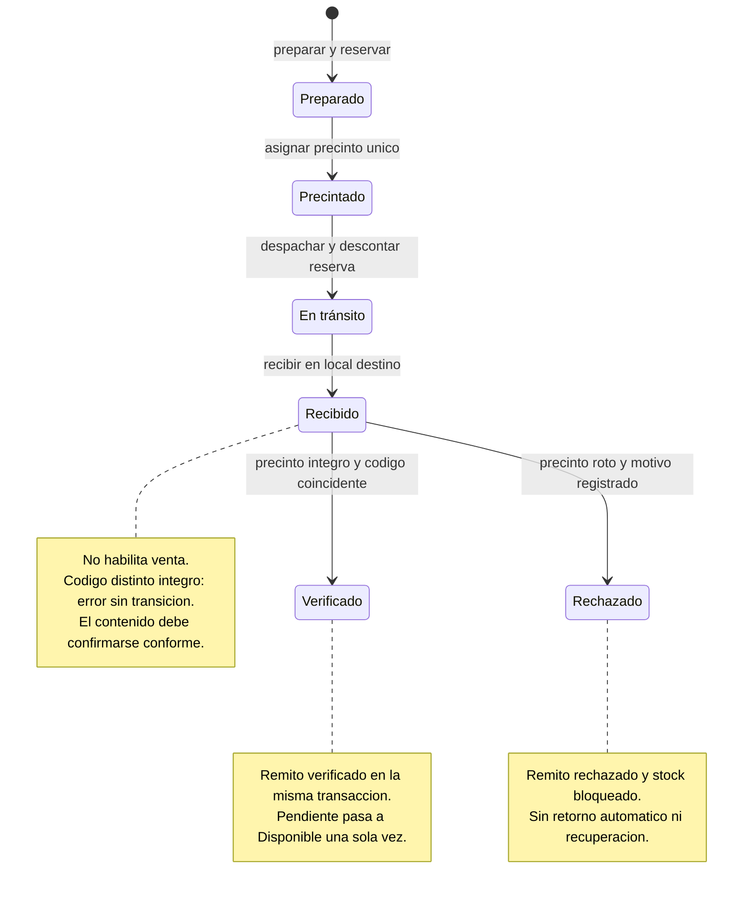

# Ciclo de vida del bulto

Diagrama actualizado con el flujo implementado el 22/10/2026. Las transiciones propuestas desarrollan el ciclo y las validaciones del enunciado; los efectos de stock se confirman junto con el historial.

| Acción | Stock | Registro conjunto |
| --- | --- | --- |
| Preparar | Disponible del CD disminuye y Reservado aumenta | Contenido, remito y transición inicial Preparado |
| Precintar | Sin movimiento adicional | Precinto único y transición Precintado |
| Despachar | Reservado del CD disminuye; contenido pasa a tránsito | Transición En tránsito |
| Recibir | Aumenta Pendiente en el local; Disponible sigue igual | Transición Recibido y destino validado |
| Verificar | Pendiente disminuye y Disponible aumenta | Bulto y remito Verificados; historial y movimiento |
| Rechazar | Pendiente disminuye y Rechazado aumenta | Bulto y remito Rechazados; evidencia del precinto roto |

No hay acciones hacia atrás ni cancelación. Una operación repetida se rechaza sin volver a afectar cantidades. Cada bulto tiene un remito propio; el rechazo de un bulto no bloquea otro remito verificado.

El código asignado al precinto no se altera en recepción. Un código distinto observado queda bloqueado mientras el bulto siga Recibido; esta validación fallida no agrega una transición. El sistema no registra todavía una incidencia específica por diferencias de contenido: el operador debe resolverlas antes de confirmar conformidad.

Fuente editable: [estados_bulto.mmd](diagramas/estados_bulto.mmd). Implementación: [estados_bulto.py](../backend/patterns/estados_bulto.py), [Bulto](../backend/models/entidades.py) y [Sistema](../backend/services/sistema.py).
