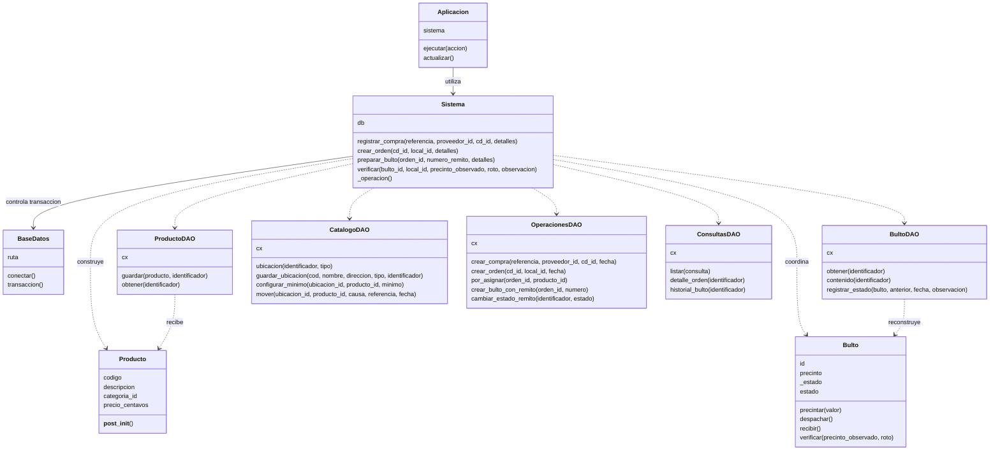
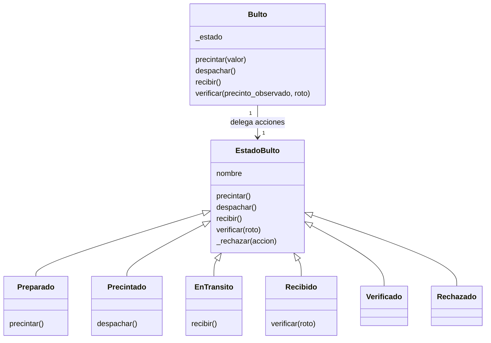

# Diagrama de clases implementadas

Revisión del 22/10/2026 contra los módulos Python. Muestra clases y dependencias existentes; algunos métodos secundarios y auxiliares de pantalla se omiten por legibilidad. El [modelo conceptual](modelo_conceptual.md) conserva la visión del dominio, incluidos procesos comerciales todavía no implementados.

## Capas y colaboración

Los DAOs reciben la misma conexión `cx` creada por la transacción del servicio. No heredan de una clase DAO general ni hacen commits propios. `Sistema` coordina el caso de uso; `BaseDatos` gestiona conexión, BEGIN IMMEDIATE, commit y rollback. No se identifica esa clase como Singleton.

`Producto` es una dataclass inmutable (`frozen=True`). Sus datos se validan al construirlo. La modificación comercial se tramita mediante `Sistema.guardar_producto()` y ProductoDAO; no existe un método `Producto.modificarPrecio()` en el código actual. Categoría, Ubicación, Compra, Orden y Remito son conceptos y tablas, pero actualmente sus filas se manejan mediante dict/sqlite3.Row; no se dibujan como clases Python inexistentes.

## Participantes reales de State

`EstadoBulto` es una clase base concreta con rechazo por defecto. La herencia usa líneas continuas porque los seis estados son subclases Python, no realizaciones de una interfaz formal. Cada estado habilitado devuelve el siguiente objeto de estado; Bulto conserva la nueva referencia. Verificado y Rechazado heredan el rechazo de todas las acciones y no tienen recuperación implementada.

Antes de delegar verificación, Bulto valida el código observado y el tipo booleano de la inspección. Si está roto, se pasa a Rechazado; si está íntegro pero el código difiere, se lanza ErrorDominio y permanece Recibido. El servicio exige destino correcto y motivo para un rechazo, y persiste estado, remito, historial y movimientos atómicamente.

`estado` es una propiedad de solo lectura; el frontend no asigna libremente el estado. El historial no es una clase TransicionEstado en el código: se conserva en la tabla historial_bulto y se consulta mediante DAO.

Fuentes editables: [clases.mmd](diagramas/clases.mmd) y [state_clases.mmd](diagramas/state_clases.mmd). Véanse también [ciclo del bulto](ciclo_bulto.md), [secuencia de verificación](secuencia_verificacion.md) y [justificación de patrones](patrones.md).
