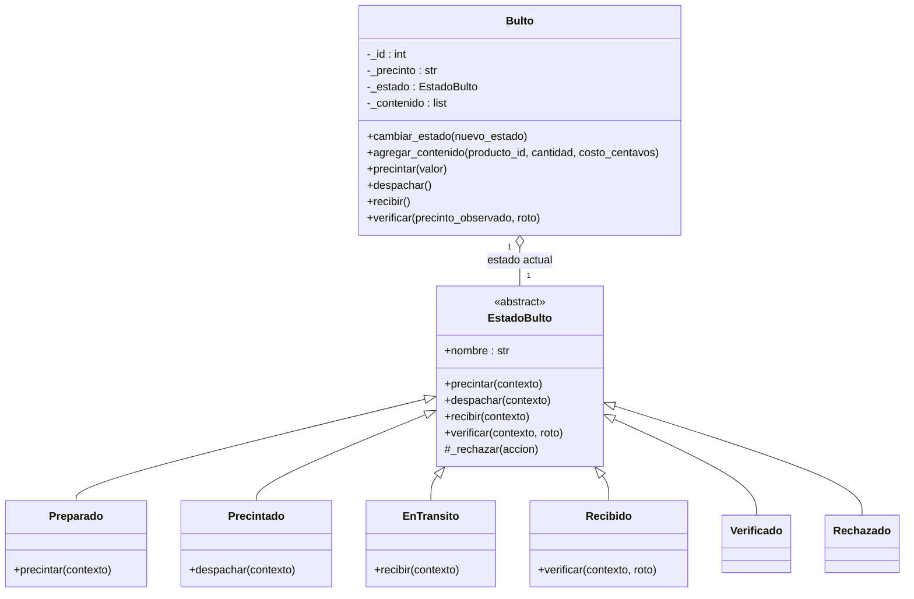

# Diagrama de clases implementadas

Revisión del 27/10/2026 contra los módulos Python. Muestra las clases del dominio orientadas a objetos, sus relaciones de herencia, composición, patrones (`State`, `Singleton` y `DAO`) y dependencias existentes.

## Capas, dominio y colaboración

```mermaid
classDiagram
    class Aplicacion {
        sistema
        ejecutar(accion)
        actualizar()
    }
    class Sistema {
        db : BaseDatos
        registrar_compra(referencia, proveedor_id, cd_id, detalles)
        crear_orden(cd_id, local_id, detalles)
        preparar_bulto(orden_id, numero_remito, detalles)
        verificar(bulto_id, local_id, precinto_observado, roto, observacion)
        registrar_venta(local_id, detalles, cobros, numero_comprobante)
        _operacion()
    }
    class BaseDatos {
        <<Singleton>>
        -_instance : BaseDatos
        -_initialized : bool
        -_ruta : Path
        +__new__(cls, ruta) : BaseDatos
        +obtener_instancia(ruta) : BaseDatos
        +reset_for_testing()
        +conectar()
        +transaccion()
    }
    class Ubicacion {
        -_codigo : str
        -_nombre : str
        -_direccion : str
        -_tipo : str
        +crear(cod, nombre, direccion, tipo, id)
    }
    class CentroDistribucion
    class Local
    class Categoria {
        -_nombre : str
    }
    class Proveedor {
        -_codigo : str
        -_nombre : str
    }
    class Producto {
        -_codigo : str
        -_descripcion : str
        -_categoria_id : int
        -_precio_centavos : int
        +precio : str
    }
    class Compra {
        -_referencia : str
        -_proveedor_id : int
        -_cd_id : int
        -_detalles : list
        +agregar_detalle(producto_id, cantidad, costo)
        +total_centavos : int
    }
    class DetalleCompra {
        -_producto_id : int
        -_cantidad : int
        -_costo_centavos : int
        +subtotal_centavos : int
    }
    class OrdenReposicion {
        -_cd_id : int
        -_local_id : int
        -_detalles : list
        +agregar_detalle(producto_id, cantidad)
        +cantidad_total : int
    }
    class DetalleReposicion {
        -_producto_id : int
        -_cantidad : int
    }
    class Remito {
        -_numero : str
        -_orden_id : int
        -_estado : str
    }
    class Bulto {
        -_id : int
        -_precinto : str
        -_estado : EstadoBulto
        -_contenido : list
        +cambiar_estado(nuevo_estado)
        +agregar_contenido(producto_id, cantidad, costo_centavos)
        +precintar(valor)
        +despachar()
        +recibir()
        +verificar(precinto_observado, roto)
    }
    class ContenidoBulto {
        -_producto_id : int
        -_cantidad : int
        -_costo_centavos : int
    }
    class Venta {
        -_id : int
        -_local_id : int
        -_detalles : list
        -_cobros : list
        -_comprobante : Comprobante
        +agregar_detalle(producto_id, cantidad, precio, costo)
        +agregar_cobro(medio_pago, monto)
        +emitir_comprobante(numero)
        +validar_operacion()
        +total_centavos : int
        +costo_total_centavos : int
        +margen_centavos : int
    }
    class DetalleVenta {
        -_producto_id : int
        -_cantidad : int
        -_precio_unitario_centavos : int
        -_costo_unitario_centavos : int
        +subtotal_centavos : int
        +costo_total_centavos : int
        +margen_centavos : int
    }
    class Cobro {
        -_medio_pago : str
        -_importe_centavos : int
        +importe : str
    }
    class Comprobante {
        -_numero : str
        -_venta_id : int
        -_total_centavos : int
        +total : str
    }
    class ProductoDAO {
        cx
        guardar(producto, identificador)
        obtener(identificador)
    }
    class BultoDAO {
        cx
        obtener(identificador)
        contenido(identificador)
        registrar_estado(bulto, anterior, fecha, observacion)
    }
    class CatalogoDAO {
        cx
        ubicacion(identificador, tipo)
        guardar_ubicacion(cod, nombre, direccion, tipo, identificador)
        configurar_minimo(ubicacion_id, producto_id, minimo)
        mover(ubicacion_id, producto_id, causa, referencia, fecha)
    }
    class OperacionesDAO {
        cx
        crear_compra(referencia, proveedor_id, cd_id, fecha)
        crear_orden(cd_id, local_id, fecha)
        por_asignar(orden_id, producto_id)
        crear_bulto_con_remito(orden_id, numero)
        cambiar_estado_remito(identificador, estado)
    }
    class VentaDAO {
        cx
        crear_venta(venta)
        guardar_detalle(venta_id, detalle)
        guardar_cobro(venta_id, cobro, fecha)
        guardar_comprobante(comprobante)
        registrar_movimiento_caja(local_id, tipo, medio_pago, importe_centavos, causa, ref_id, fecha)
        obtener(identificador)
    }
    class ConsultasDAO {
        cx
        listar(consulta)
        detalle_orden(identificador)
        historial_bulto(identificador)
        detalle_venta(identificador)
        cobros_venta(identificador)
        comprobante_venta(identificador)
    }
    Ubicacion <|-- CentroDistribucion
    Ubicacion <|-- Local
    Compra "1" *-- "1..*" DetalleCompra : contiene
    OrdenReposicion "1" *-- "1..*" DetalleReposicion : contiene
    Bulto "1" *-- "1..*" ContenidoBulto : contiene
    Bulto "1" --> "0..1" Remito : documentado por
    Venta "1" *-- "1..*" DetalleVenta : contiene
    Venta "1" *-- "1..*" Cobro : registra
    Venta "1" *-- "1" Comprobante : emite
    Aplicacion --> Sistema : utiliza
    Sistema --> BaseDatos : instancia unica
    Sistema ..> Ubicacion : instancia
    Sistema ..> Producto : instancia
    Sistema ..> Compra : instancia
    Sistema ..> OrdenReposicion : instancia
    Sistema ..> Bulto : coordina
    Sistema ..> Venta : coordina
    Sistema ..> ProductoDAO
    Sistema ..> BultoDAO
    Sistema ..> CatalogoDAO
    Sistema ..> OperacionesDAO
    Sistema ..> VentaDAO
    Sistema ..> ConsultasDAO
    ProductoDAO ..> Producto : recibe
    BultoDAO ..> Bulto : reconstruye
    VentaDAO ..> Venta : persiste y reconstruye
```

`BaseDatos` implementa el patrón **Singleton** según GoF (Cap. 15.3), almacenando su instancia única en `_instance`, controlando la instanciación mediante `__new__` y la inicialización única mediante `_initialized`, además de exponer `reset_for_testing()` (Cap. 15.5.2).

Las entidades del dominio (`Categoria`, `Proveedor`, `Ubicacion`, `CentroDistribucion`, `Local`, `Producto`, `Compra`, `DetalleCompra`, `OrdenReposicion`, `DetalleReposicion`, `Remito`, `Bulto`, `ContenidoBulto`, `Venta`, `DetalleVenta`, `Cobro`, `Comprobante`) siguen las pautas de las guías de clase:
- **Encapsulamiento (Cap. 8):** atributos privados con prefijo `_`, acceso mediante `@property` y `@setter` que validan la coherencia del estado interno, atributos calculados (`precio`, `subtotal_centavos`, `costo_total_centavos`, `margen_centavos`, `total_centavos`, `cantidad_total`) y métodos mágicos `__str__` y `__eq__`.
- **Composición (Cap. 9):** las clases contenedoras (`Compra`, `OrdenReposicion`, `Bulto` y `Venta`) inicializan sus colecciones internas vacías en `__init__` y exponen métodos de agregado (`agregar_detalle`, `agregar_contenido`, `agregar_cobro`, `emitir_comprobante`).
- **Herencia (Cap. 10):** `CentroDistribucion` y `Local` especializan a `Ubicacion` invocando `super().__init__(...)`.

## Participantes reales de State

`EstadoBulto` hereda de `ABC` (`abc.ABC`) y define la propiedad abstracta `@abstractmethod def nombre(self)`, impidiendo su instanciación directa (Cap. 11.2). Cada estado concreto habilitado recibe al contexto (`Bulto`) como argumento e invoca `contexto.cambiar_estado(SiguienteEstado())` (Cap. 16.2).

Fuentes editables: [clases.mmd](diagramas/clases.mmd) y [state_clases.mmd](diagramas/state_clases.mmd). Véanse también [ciclo del bulto](ciclo_bulto.md), [secuencia de verificación](secuencia_verificacion.md) y [justificación de patrones](patrones.md).
