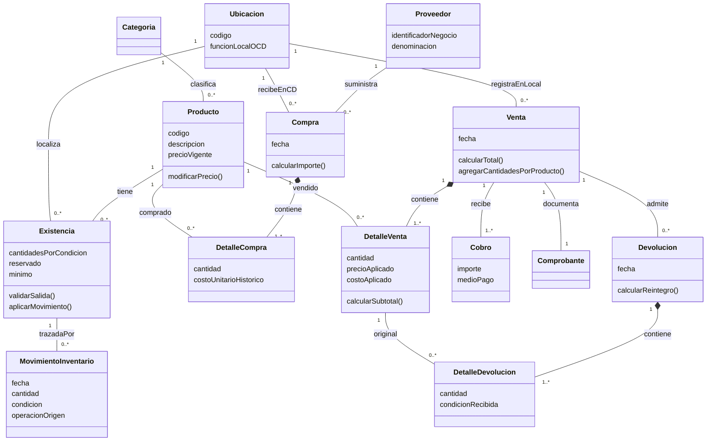
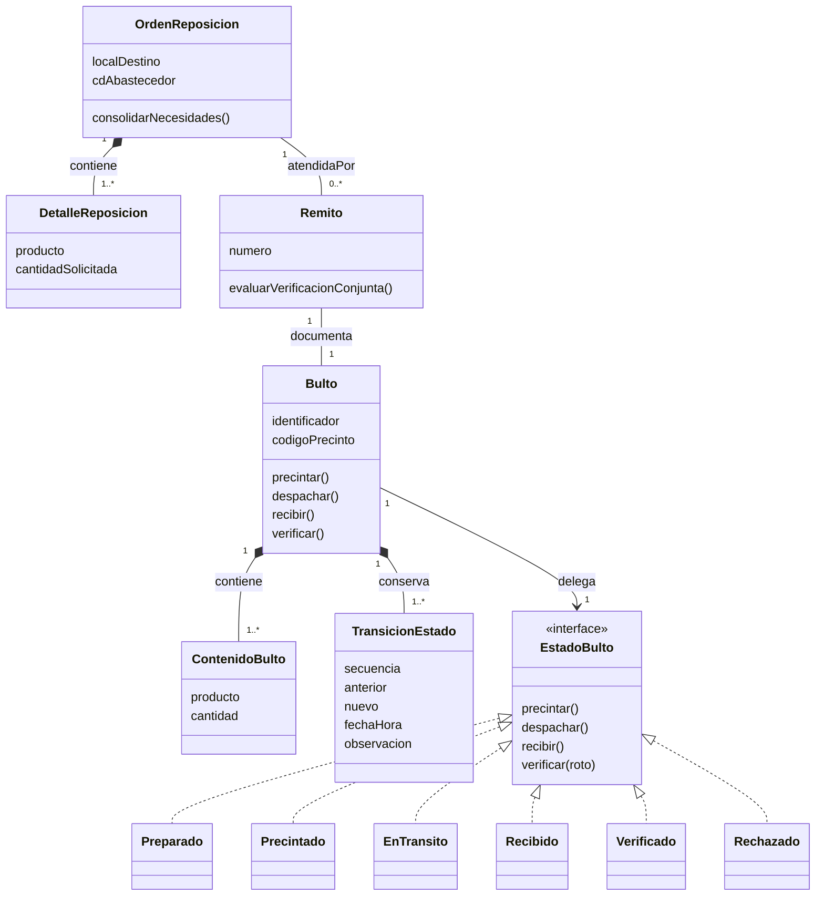
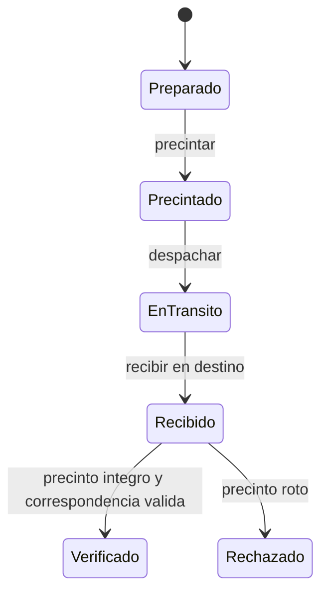

# Modelo conceptual del dominio

Versión 0.2, 22/10/2026. Modelo conceptual actualizado con el incremento de catálogo y logística. Las clases comerciales son diseño de los incrementos siguientes; no están implementadas. El DER vigente está en [modelo de datos](modelo_datos.md). Se apoya en los [casos de uso](casos_uso.md) y conserva las decisiones pendientes del [análisis](analisis_dominio.md).

## Catálogo, operaciones e inventario

Este es un modelo conceptual, no un inventario de clases programadas: los nombres y métodos expresan responsabilidades de diseño. Para las clases reales, consultar [modelo de clases implementadas](modelo_clases.md). Se muestran conceptos y responsabilidades principales. Las multiplicidades se refieren a operaciones confirmadas. Producto tiene una categoría y la existencia es por producto/ubicación según D01/D02. Ubicación es una abstracción conceptual: no se decide aún una jerarquía Local/CD.

Restricciones que el dibujo no expresa: Compra solo ingresa a CD; Venta solo ocurre en local; un par producto/ubicación identifica su existencia; reserva no aumenta físico; un movimiento tiene causa inequívoca. Los cobros y reintegros originan movimientos de caja, omitidos del dibujo para mantenerlo legible pero incluidos en CU08/CU09. La relación Existencia-Movimiento es una decisión preliminar; al modelar el DER se debe asegurar que permite registrar la primera entrada y reconciliar saldos.

La unicidad global se comprueba en administración/persistencia, no en un Producto aislado. Venta suma sus detalles; el servicio obtiene la existencia del local y coordina venta, cobros, caja y comprobante. Devolución valida sus datos y necesita la venta y acumulados recuperados para controlar cantidades.

## Logística y State

State ya está aplicado en Bulto. Los conceptos OrdenReposicion, Remito, ContenidoBulto y TransicionEstado del dibujo expresan responsabilidades conceptuales; actualmente se conservan como registros SQLite, no como clases Python independientes.

Las relaciones Orden-Remito-Bulto implementan una orden por local y un remito por bulto. Una orden puede atenderse parcialmente con varios bultos/remitos, sin superar sus cantidades pendientes. Las composiciones representan pertenencia, no permiso de borrar el historial. Cada estado admite sus acciones y rechaza las incompatibles; el usuario envía acciones a Bulto y no asigna libremente el siguiente estado. Estado actual e historial deben persistirse juntos. State decide transiciones, pero no sustituye la transacción ni habilita por sí solo el stock.

Recibido no habilita venta. Verificado solo permite habilitar su contenido si el remito también está Verificado. Con precinto distinto o contenido inconsistente se mantiene bloqueo y se registra evidencia; la salida de esa incidencia sigue pendiente. No se dibuja recuperación de Rechazado hasta definirla.

## Colaboración de una verificación

1. Frontend envía identificación de bulto y evidencia al servicio de recepción/verificación.
2. El servicio carga Bulto, Remito e inventario en una misma unidad de trabajo.
3. Bulto delega la acción en su EstadoBulto, que devuelve el siguiente estado permitido; el servicio registra la transición y conserva evidencia mediante DAO.
4. El servicio actualiza el remito del único bulto y comprueba la condición conjunta. Solo la condición conjunta permite preparar la habilitación de inventario.
5. El servicio persiste estados, historial y movimientos/saldos correspondientes, confirmando todo o revirtiendo todo. Una operación ya aplicada no vuelve a sumar mercadería.
6. Frontend muestra el resultado confirmado.

DAO ya está aplicado al acceso a datos. El servicio usa BultoDAO, ProductoDAO, CatalogoDAO, OperacionesDAO y ConsultasDAO; ninguno confirma transacciones por separado. El tercer patrón no está seleccionado: no se presenta un servicio, mapa de estados o medio de pago como patrón adicional sin demostrar su estructura y problema.
