# Modelo de datos implementado: catálogo, logística, ventas y devoluciones

SQLite 3. Revisión del 31/10/2026. Fuente ejecutable: [esquema SQL](../backend/database/esquema.sql). Decisiones: [reglas adoptadas](decisiones_implementacion.md).

## DER lógico con atributos y claves

```mermaid
erDiagram
    UBICACION {
        int id PK
        string codigo UK
        string nombre
        string direccion
        string tipo
    }
    CATEGORIA {
        int id PK
        string nombre UK
    }
    PROVEEDOR {
        int id PK
        string codigo UK
        string nombre
    }
    PRODUCTO {
        int id PK
        string codigo UK
        string descripcion
        int categoria_id FK
        int precio_centavos
    }
    EXISTENCIA {
        int ubicacion_id PK, FK
        int producto_id PK, FK
        int disponible
        int reservado
        int pendiente
        int rechazado
        int minimo
        int costo_centavos
    }
    COMPRA {
        int id PK
        string referencia UK
        int proveedor_id FK
        int cd_id FK
        string fecha
    }
    DETALLE_COMPRA {
        int compra_id PK, FK
        int producto_id PK, FK
        int cantidad
        int costo_centavos
    }
    ORDEN_REPOSICION {
        int id PK
        int cd_id FK
        int local_id FK
        string fecha
    }
    DETALLE_REPOSICION {
        int orden_id PK, FK
        int producto_id PK, FK
        int cantidad
    }
    REMITO {
        int id PK
        string numero UK
        int orden_id FK
        string estado
    }
    BULTO {
        int id PK
        int remito_id FK, UK
        string precinto UK
        string estado
    }
    CONTENIDO_BULTO {
        int bulto_id PK, FK
        int producto_id PK, FK
        int cantidad
        int costo_centavos
    }
    HISTORIAL_BULTO {
        int id PK
        int bulto_id FK
        string anterior
        string nuevo
        string fecha
        string observacion
    }
    MOVIMIENTO_INVENTARIO {
        int id PK
        int ubicacion_id FK
        int producto_id FK
        int disponible
        int reservado
        int pendiente
        int rechazado
        string causa
        int referencia_id
        string fecha
    }
    VENTA {
        int id PK
        int local_id FK
        string fecha
        int total_centavos
    }
    DETALLE_VENTA {
        int id PK
        int venta_id FK
        int producto_id FK
        int cantidad
        int precio_unitario_centavos
        int costo_unitario_centavos
    }
    COBRO {
        int id PK
        int venta_id FK
        string medio_pago
        int importe_centavos
        string fecha
    }
    COMPROBANTE {
        int id PK
        string numero UK
        int venta_id FK, UK
        string fecha
        int total_centavos
    }
    MOVIMIENTO_CAJA {
        int id PK
        int local_id FK
        string tipo
        string medio_pago
        int importe_centavos
        string causa
        int referencia_id
        string fecha
    }
    CATEGORIA ||--o{ PRODUCTO : clasifica
    UBICACION ||--o{ EXISTENCIA : mantiene
    PRODUCTO ||--o{ EXISTENCIA : tiene
    PROVEEDOR ||--o{ COMPRA : suministra
    UBICACION ||--o{ COMPRA : recibe_en_CD
    COMPRA ||--|{ DETALLE_COMPRA : contiene
    PRODUCTO ||--o{ DETALLE_COMPRA : comprado
    UBICACION ||--o{ ORDEN_REPOSICION : abastece_desde_CD
    UBICACION ||--o{ ORDEN_REPOSICION : solicita_para_local
    ORDEN_REPOSICION ||--|{ DETALLE_REPOSICION : contiene
    PRODUCTO ||--o{ DETALLE_REPOSICION : solicitado
    ORDEN_REPOSICION ||--o{ REMITO : atendida_por
    REMITO ||--|| BULTO : documenta
    BULTO ||--|{ CONTENIDO_BULTO : contiene
    PRODUCTO ||--o{ CONTENIDO_BULTO : transportado
    BULTO ||--|{ HISTORIAL_BULTO : registra
    UBICACION ||--o{ MOVIMIENTO_INVENTARIO : afectada
    PRODUCTO ||--o{ MOVIMIENTO_INVENTARIO : afectado
    UBICACION ||--o{ VENTA : registra_en_local
    VENTA ||--|{ DETALLE_VENTA : contiene
    PRODUCTO ||--o{ DETALLE_VENTA : vendido
    VENTA ||--|{ COBRO : recibe
    VENTA ||--|| COMPROBANTE : documenta
    UBICACION ||--o{ MOVIMIENTO_CAJA : opera_caja
    DEVOLUCION {
        int id PK
        string referencia UK
        int venta_id FK
        int local_id FK
        string motivo
        string medio_reintegro
        string fecha
        int total_centavos
    }
    DETALLE_DEVOLUCION {
        int id PK
        int devolucion_id FK
        int detalle_venta_id FK
        int cantidad
        string condicion
    }
    VENTA ||--o{ DEVOLUCION : origen
    UBICACION ||--o{ DEVOLUCION : reintegra
    DEVOLUCION ||--|{ DETALLE_DEVOLUCION : contiene
    DETALLE_VENTA ||--o{ DETALLE_DEVOLUCION : limita
    LOTE {
        int id PK
        int producto_id FK
        string codigo
        string vencimiento
        int legado
    }
    EXISTENCIA_LOTE {
        int ubicacion_id PK, FK
        int lote_id PK, FK
        int disponible
        int reservado
        int pendiente
        int rechazado
    }
    COMPRA_LOTE {
        int compra_id PK, FK
        int lote_id PK, FK
        int cantidad
    }
    BULTO_LOTE {
        int bulto_id PK, FK
        int lote_id PK, FK
        int cantidad
    }
    VENTA_LOTE {
        int detalle_venta_id PK, FK
        int lote_id PK, FK
        int cantidad
    }
    DEVOLUCION_LOTE {
        int detalle_devolucion_id PK, FK
        int lote_id PK, FK
        int cantidad
    }
    MOVIMIENTO_LOTE {
        int id PK
        int ubicacion_id FK
        int lote_id FK
        int disponible
        int reservado
        int pendiente
        int rechazado
        string causa
        int referencia_id
        string fecha
    }
    ORDEN_COMPRA_SUGERIDA {
        int id PK
        string referencia UK
        int cd_id FK
        int proveedor_id FK
        string fecha
        string estado
        int compra_id FK, UK
    }
    DETALLE_COMPRA_SUGERIDA {
        int orden_id PK, FK
        int producto_id PK, FK
        int cantidad
    }
    PRODUCTO ||--o{ LOTE : identifica
    UBICACION ||--o{ EXISTENCIA_LOTE : mantiene
    LOTE ||--o{ EXISTENCIA_LOTE : tiene
    COMPRA ||--|{ COMPRA_LOTE : recibe
    LOTE ||--o{ COMPRA_LOTE : ingresa
    BULTO ||--|{ BULTO_LOTE : asigna
    LOTE ||--o{ BULTO_LOTE : viaja
    DETALLE_VENTA ||--|{ VENTA_LOTE : consume
    LOTE ||--o{ VENTA_LOTE : vendido
    DETALLE_DEVOLUCION ||--|{ DEVOLUCION_LOTE : retorna
    LOTE ||--o{ DEVOLUCION_LOTE : devuelto
    LOTE ||--o{ MOVIMIENTO_LOTE : traza
    UBICACION ||--o{ MOVIMIENTO_LOTE : afecta
    UBICACION ||--o{ ORDEN_COMPRA_SUGERIDA : compra_en_CD
    PROVEEDOR ||--o{ ORDEN_COMPRA_SUGERIDA : elegido
    ORDEN_COMPRA_SUGERIDA ||--|{ DETALLE_COMPRA_SUGERIDA : contiene
    PRODUCTO ||--o{ DETALLE_COMPRA_SUGERIDA : necesita
    ORDEN_COMPRA_SUGERIDA |o--o| COMPRA : recibida_como
```

## Datos y restricciones

| Tabla | Identidad y datos principales | Restricciones |
| --- | --- | --- |
| `ubicacion` | id; código, nombre, dirección, tipo | Código único, tipos CD/LOCAL; índice parcial admite solo un CD. |
| `categoria` | id; nombre | Nombre único sin distinción ASCII de mayúsculas/minúsculas (`NOCASE`). |
| `proveedor` | id; código, nombre | Código de negocio único normalizado. |
| `producto` | id; código, descripción, categoría, precio en centavos | Código único; FK categoría; importe no negativo. |
| `existencia` | PK compuesta ubicación/producto; disponible, reservado, pendiente, rechazado, mínimo, `costo_centavos` | FK a ambos extremos; valores no negativos. `costo_centavos` conserva el promedio ponderado del Disponible; excluye reservas, pendientes y rechazados. Con disponible cero no representa valor de stock. |
| `compra` | id; referencia, proveedor, CD, fecha | Referencia única y FK a proveedor/ubicación; el servicio exige CD. |
| `detalle_compra` | PK compra/producto; cantidad, costo en centavos | Cantidad positiva; costo histórico no negativo; actualiza el costo promedio del CD. |
| `orden_reposicion` | id; CD, local, fecha | FK a ubicaciones distintas; el servicio exige sus funciones. |
| `detalle_reposicion` | PK orden/producto; cantidad | Cantidad positiva y FK a ambos extremos. |
| `remito` | id; número, orden, estado | Número único; Pendiente, Verificado o Rechazado. |
| `bulto` | id; remito, precinto, estado | Remito único; precinto único desde su asignación; seis estados oficiales controlados por CHECK y State. |
| `contenido_bulto` | PK bulto/producto; cantidad, `costo_centavos` | Cantidad positiva; captura el costo unitario del CD al preparar el bulto para transferirlo al local cuando se verifique. |
| `historial_bulto` | id secuencial; bulto, anterior/nuevo, fecha, observación | Solo anexado. Triggers impiden modificar/borrar. |
| `movimiento_inventario` | id; ubicación/producto, deltas por condición, causa, referencia, fecha | FK ubicación/producto; combinación ubicación/producto/causa/referencia única evita efectos repetidos. |
| `venta` | id; local, fecha, `total_centavos` | FK a ubicación de tipo LOCAL; total no negativo. |
| `detalle_venta` | id; venta, producto, cantidad, `precio_unitario_centavos`, `costo_unitario_centavos` | `UNIQUE (venta_id, producto_id)`; conserva precio de venta y costo promedio histórico aplicados en la operación. |
| `cobro` | id; venta, `medio_pago`, `importe_centavos`, fecha | Importe positivo; la suma de cobros de la venta debe igualar exactamente su total. |
| `comprobante` | id; número único, venta única, fecha, `total_centavos` | Relación 1 a 1 con `venta`; documenta la operación comercial. |
| `movimiento_caja` | id; local, tipo (`INGRESO`/`EGRESO`), `medio_pago`, `importe_centavos`, causa, `referencia_id`, fecha | Registra el ingreso de caja por cada cobro confirmado. |

Fuente editable del diagrama: [der.mmd](diagramas/der.mmd).

## Migración de costos

El esquema actual usa `PRAGMA user_version = 3`. El paso 2 incorpora devoluciones, índice por detalle original y trigger de pertenencia/cantidad; el paso 3 añade compras sugeridas y lotes/vencimientos. La versión económica 1 se conserva como paso previo; al actualizar de 1 a 2 no se reconstruyen costos ni se alteran ventas. Las bases nuevas o de versión 0 completan ambos pasos en la transacción de apertura. Las bases previas no tenían versión (`0`). La creación del esquema, columnas faltantes, reconstrucción y cambio de versión se confirman juntos bajo `BEGIN IMMEDIATE`. Si falla una comprobación, se revierten todos esos cambios y se puede reintentar después de conciliar el respaldo. Una versión superior se rechaza para evitar abrirla con código anterior.

La reconstrucción recorre `movimiento_inventario` por su id global, no por fecha: compra → preparación → despacho → recepción → verificación/rechazo → venta. Cada compra aporta su costo histórico; al preparar se apartan unidades del promedio Disponible y se fija el costo del bulto. Las bases que no tenían la columna de costo del contenido la completan a partir de esa secuencia. Al verificar, el costo del bulto se promedia con el Disponible del local; un rechazo no habilita unidades ni altera ese promedio.

Si la base ya tenía costos de bultos y ventas registrados, se respetan esos históricos, incluso valores cero. Las diferencias entre salidas históricas y promedio reconstruido se asignan al stock Disponible remanente. No se recalculan márgenes de ventas pasadas ni se inventan costos faltantes. Si el valor restante es negativo o existe una diferencia significativa sin unidades remanentes, se informa que hace falta conciliación y se revierte la migración. Una base ya migrada por versiones anteriores con costos cero requiere revisar esos documentos: cero no permite distinguir por sí solo mercadería gratuita de un dato económico perdido.

Se contrastan movimientos con sus documentos y con los cuatro saldos por ubicación/producto. No se modifican cantidades, mínimos, comprobantes, caja ni historial de estados. La migración se ejecuta una sola vez; las siguientes aperturas conservan los costos operados. Los promedios unitarios se redondean a centavos con `ROUND_HALF_UP`, por lo que puede haber diferencias de redondeo al valorizar muchas unidades.

## Documentos de devolución

| Tabla | Datos y restricciones |
| --- | --- |
| `devolucion` | id, referencia única, venta/local FK, motivo, medio de reintegro, fecha y total en centavos no negativo. |
| `detalle_devolucion` | id, devolución y detalle de venta FK, cantidad positiva y condición VENDIBLE/NO_VENDIBLE. Único por devolución/detalle/condición; índice por detalle original. |

El trigger de inserción exige pertenencia a la venta/local y acumulado no superior al vendido; el servicio valida lo mismo bajo BEGIN IMMEDIATE. Precio y costo se recuperan del detalle de venta histórico. Una devolución puede registrar dos condiciones del mismo producto y produce un único movimiento de inventario por producto, con ambos deltas. El egreso de caja usa causa DEVOLUCION y referencia al documento; si el total es cero, no se inserta egreso. No se editan ni eliminan documentos confirmados desde la aplicación.

## Lotes y compras sugeridas: esquema 3

| Tabla | Datos y restricciones |
| --- | --- |
| `lote` | id, producto FK, código único por producto, vencimiento opcional y bandera legado. Código/fecha validados en dominio y conservados desde el alta. |
| `existencia_lote` | PK ubicación/lote; Disponible, Reservado, Pendiente, Rechazado no negativos. Su suma por producto coincide con existencia agregada. |
| `compra_lote`, `bulto_lote` | PK documento/lote; cantidad positiva. Registran ingreso y asignación real a bulto. |
| `venta_lote`, `devolucion_lote` | PK detalle/lote; cantidad positiva. La devolución limita su acumulado al lote y detalle originales. |
| `movimiento_lote` | Documento/causa/fecha y deltas por ubicación/lote. Único por ubicación/lote/causa/referencia; no se sobrescriben movimientos. |
| `orden_compra_sugerida` | Referencia única, CD/proveedor FK, fecha, estado SUGERIDA/RECIBIDA/CANCELADA y compra FK única. CHECK exige compra asociada solo cuando RECIBIDA. |
| `detalle_compra_sugerida` | PK orden/producto, cantidad positiva. No es una entrada de stock. |

La migración 2 → 3 crea un lote legado por producto y copia los saldos actuales, sin tocar costos ni documentos. Las asignaciones de operaciones previas quedan marcadas de origen desconocido; no se fabrican recepciones ni movimientos históricos por lote. Nuevas operaciones registran ambas capas en una sola transacción. [Políticas y límites](opcionales.md).
