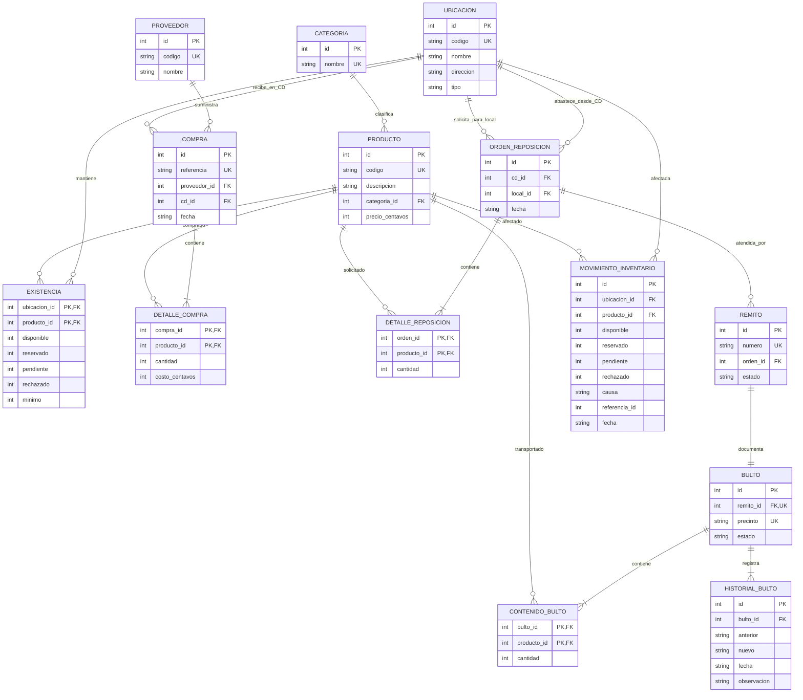

# Modelo de datos implementado: catálogo y logística

SQLite 3. Versión inicial del 22/10/2026. Fuente ejecutable: [esquema SQL](../backend/database/esquema.sql). Decisiones: [reglas adoptadas](decisiones_implementacion.md).

## DER lógico con atributos y claves

Orden tiene dos referencias a Ubicación: CD origen y local destino; Compra solo referencia un CD. Ambas relaciones se dibujan por separado con sus roles. Los tipos int/string describen INTEGER/TEXT de SQLite. PK es clave primaria, FK clave foránea y UK unicidad; las PK compuestas se marcan en cada columna participante. El índice parcial de un único CD se explica en el diccionario, no se muestra como unicidad general del tipo. Las colecciones de documentos confirmados tienen al menos un detalle; el servicio y la transacción garantizan ese mínimo, no una FK por sí sola. Remito y Bulto se crean juntos y la FK única de Bulto asegura que no comparten remito.

## Datos y restricciones

| Tabla | Identidad y datos principales | Restricciones |
| --- | --- | --- |
| ubicacion | id; código, nombre, dirección, tipo | Código único, tipos CD/LOCAL; índice parcial admite solo un CD. El servicio impide cambiar de función. |
| categoria | id; nombre | Nombre único sin distinción ASCII de mayúsculas/minúsculas (NOCASE de SQLite). |
| proveedor | id; código, nombre | Código de negocio único normalizado. |
| producto | id; código, descripción, categoría, precio en centavos | Código único; FK categoría; importe no negativo. |
| existencia | PK compuesta ubicación/producto; disponible, reservado, pendiente, rechazado, mínimo | FK a ambos extremos; todos los valores no negativos. Ausencia de fila se consulta como cero. |
| compra | id; referencia, proveedor, CD, fecha | Referencia única y FK a proveedor/ubicación; el servicio exige CD. |
| detalle_compra | PK compra/producto; cantidad, costo en centavos | Cantidad positiva; costo histórico no negativo; FK a compra/producto. |
| orden_reposicion | id; CD, local, fecha | FK a ubicaciones distintas; el servicio exige sus funciones. |
| detalle_reposicion | PK orden/producto; cantidad | Cantidad positiva y FK a ambos extremos. |
| remito | id; número, orden, estado | Número único; Pendiente, Verificado o Rechazado. |
| bulto | id; remito, precinto, estado | Remito único; precinto único desde su asignación; seis estados oficiales controlados por CHECK y State. |
| contenido_bulto | PK bulto/producto; cantidad | Cantidad positiva; servicio limita pendiente de orden y stock. |
| historial_bulto | id secuencial; bulto, anterior/nuevo, fecha, observación | Solo anexado. Triggers impiden modificar/borrar; orden por id conserva secuencia. |
| movimiento_inventario | id; ubicación/producto, deltas por condición, causa, referencia, fecha | FK ubicación/producto; combinación ubicación/producto/causa/referencia única evita efectos repetidos. |

`referencia_id` de un movimiento identifica compra para causa COMPRA y bulto para PREPARACION/DESPACHO/RECEPCION/VERIFICACION. Esa referencia depende de la causa y se mantiene desde el servicio, no mediante una FK polimórfica. Las fechas se generan al confirmar cada operación, en ISO 8601 con zona horaria.

El stock físico se obtiene sumando Disponible + Reservado + Pendiente + Rechazado. En tránsito se deriva del contenido de los bultos En tránsito y no pertenece simultáneamente al físico de ambas ubicaciones. El faltante se calcula como máximo entre cero y Mínimo menos Disponible.

## Persistencia y pendientes

`BaseDatos` activa claves foráneas en cada conexión. Los servicios abren una transacción de escritura antes de validar y modificar cantidades; los DAOs reciben esa conexión. El esquema se crea en una base nueva al arrancar. No se incluye todavía un sistema de migraciones de versiones previas.

El modelo se ampliará con venta/detalle, cobro, comprobante, devolución/detalle y caja en el siguiente incremento. Conservar costos de compra no equivale todavía a implementar valoración ni el reporte de margen.

Fuente editable del diagrama: [der.mmd](diagramas/der.mmd). Los atributos y claves se contrastaron con PRAGMA de SQLite sobre el esquema ejecutable.
