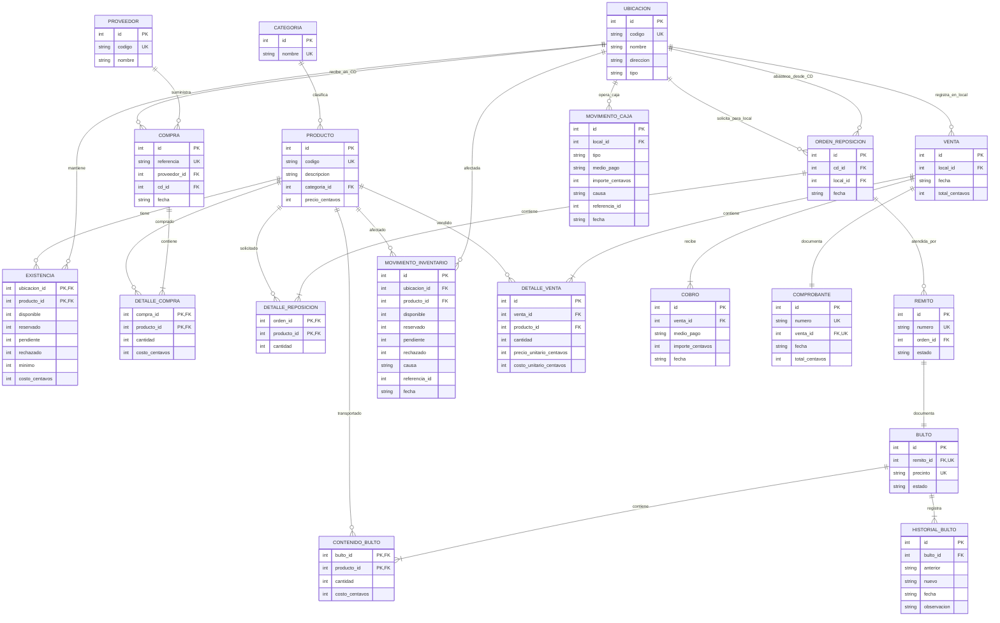

# Modelo de datos implementado: catálogo, logística y ventas

SQLite 3. Revisión del 27/10/2026. Fuente ejecutable: [esquema SQL](../backend/database/esquema.sql). Decisiones: [reglas adoptadas](decisiones_implementacion.md).

## DER lógico con atributos y claves

## Datos y restricciones

| Tabla | Identidad y datos principales | Restricciones |
| --- | --- | --- |
| `ubicacion` | id; código, nombre, dirección, tipo | Código único, tipos CD/LOCAL; índice parcial admite solo un CD. |
| `categoria` | id; nombre | Nombre único sin distinción ASCII de mayúsculas/minúsculas (`NOCASE`). |
| `proveedor` | id; código, nombre | Código de negocio único normalizado. |
| `producto` | id; código, descripción, categoría, precio en centavos | Código único; FK categoría; importe no negativo. |
| `existencia` | PK compuesta ubicación/producto; disponible, reservado, pendiente, rechazado, mínimo, `costo_centavos` | FK a ambos extremos; valores no negativos. `costo_centavos` conserva el costo promedio ponderado vigente en la ubicación. |
| `compra` | id; referencia, proveedor, CD, fecha | Referencia única y FK a proveedor/ubicación; el servicio exige CD. |
| `detalle_compra` | PK compra/producto; cantidad, costo en centavos | Cantidad positiva; costo histórico no negativo; actualiza el costo promedio del CD. |
| `orden_reposicion` | id; CD, local, fecha | FK a ubicaciones distintas; el servicio exige sus funciones. |
| `detalle_reposicion` | PK orden/producto; cantidad | Cantidad positiva y FK a ambos extremos. |
| `remito` | id; número, orden, estado | Número único; Pendiente, Verificado o Rechazado. |
| `bulto` | id; remito, precinto, estado | Remito único; precinto único desde su asignación; seis estados oficiales controlados por CHECK y State. |
| `contenido_bulto` | PK bulto/producto; cantidad, `costo_centavos` | Cantidad positiva; captura el costo unitario del CD al preparar el bulto para transferirlo al local cuando se verifique. |
| `historial_bulto` | id secuencial; bulto, anterior/nuevo, fecha, observación | Solo anexado. Triggers impiden modificar/borrar. |
| `movimiento_inventario` | id; ubicación/producto, deltas por condición, causa, referencia, fecha | FK ubicación/producto; combinación ubicación/producto/causa/referencia única evita efectos repetidos. |
| `venta` | id; local, fecha, `total_centavos` | FK a ubicación de tipo LOCAL; total no negativo. |
| `detalle_venta` | id; venta, producto, cantidad, `precio_unitario_centavos`, `costo_unitario_centavos` | `UNIQUE (venta_id, producto_id)`; conserva precio de venta y costo promedio histórico aplicados en la operación. |
| `cobro` | id; venta, `medio_pago`, `importe_centavos`, fecha | Importe positivo; la suma de cobros de la venta debe igualar exactamente su total. |
| `comprobante` | id; número único, venta única, fecha, `total_centavos` | Relación 1 a 1 con `venta`; documenta la operación comercial. |
| `movimiento_caja` | id; local, tipo (`INGRESO`/`EGRESO`), `medio_pago`, `importe_centavos`, causa, `referencia_id`, fecha | Registra el ingreso de caja por cada cobro confirmado. |

Fuente editable del diagrama: [der.mmd](diagramas/der.mmd).
