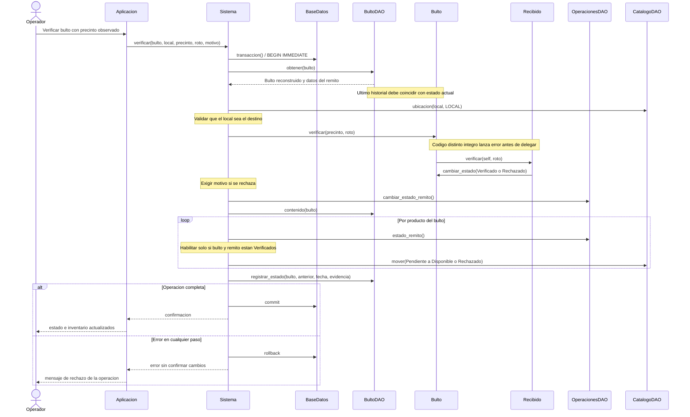

# Secuencia de verificación y transacción

Colaboración implementada entre frontend, servicio, dominio y DAOs. Todos los DAOs usan la conexión de la misma transacción. El bloque de error representa una excepción en cualquier paso: los pasos posteriores no se ejecutan y los cambios previos se revierten.

El historial, el remito y el inventario no se confirman separadamente. La prueba de fallo al insertar historial comprueba que los cambios de remito/saldos se revierten. Un bulto ya Verificado o Rechazado no vuelve a llegar a las escrituras: State rechaza la repetición.

Fuente editable: [secuencia_verificacion.mmd](diagramas/secuencia_verificacion.mmd). Casos de prueba: [test_logistica.py](../tests/test_logistica.py).
